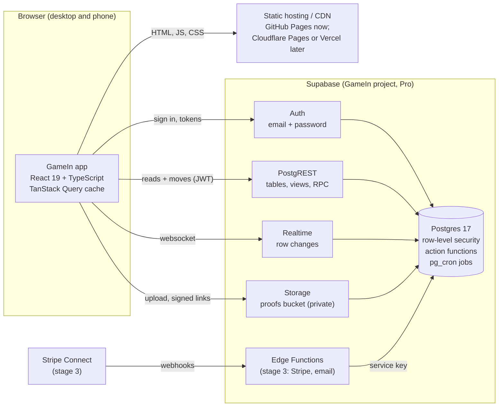
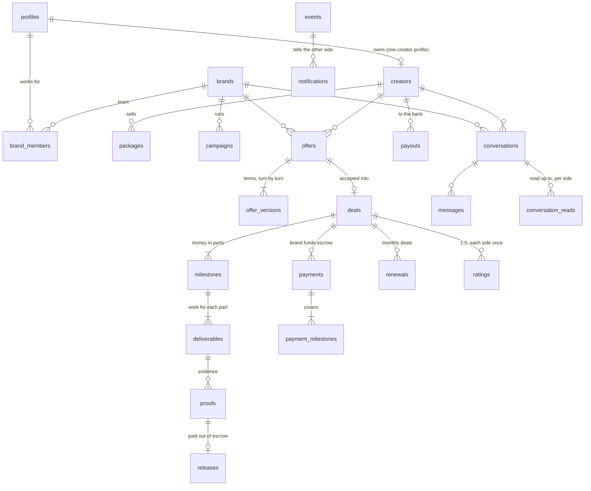
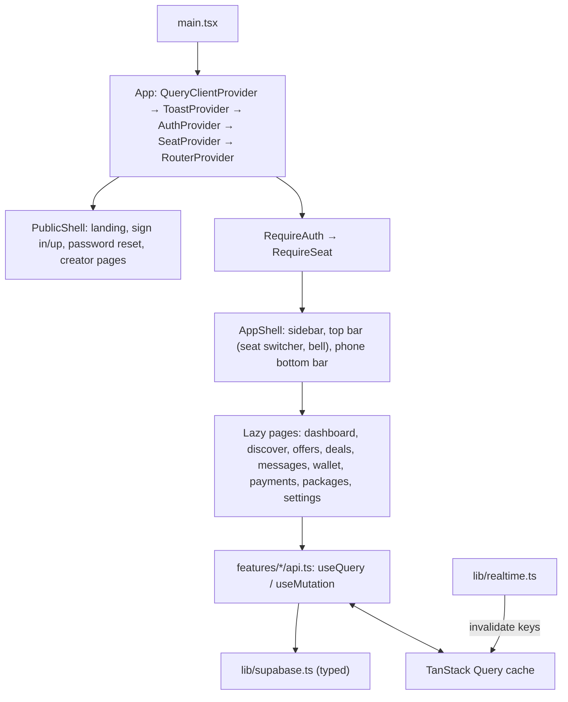

# GameIn architecture

GameIn is a two-sided sponsorship marketplace for gaming creators and brands. Brands send offers, creators accept,
the brand's money waits in escrow, the creator delivers proof, and the money is released when the brand approves.

This document describes the production app in `app/` and the backend in `supabase/` it runs on. The single-file
prototype at the repository root (`index.html`, with `live/`) stays online as the demo until the app replaces it.

How this holds up as GameIn grows (what was measured on a database of 200,000 creators, what the design is, and what
comes next and when) is in [SYSTEM_DESIGN.md](SYSTEM_DESIGN.md).

## 1. System architecture



**The principles:**

- **The database is the backend.** Every rule about offers, deals and money lives in Postgres as a transactional
  function, with its rule id: O9 is "it's not your turn", E6 is "not in escrow yet". Two moves on one deal take
  turns. The ledger is double-entry and append-only. The app never computes money it then saves. It asks the
  database to make the move, and shows what the database says.
- **Row-level security decides who sees what.** The app uses the public, publishable key. Each request carries the
  signed-in person's token, and Postgres returns only their rows. Nothing secret ships to the browser.
- **The frontend is a static single-page app.** It's stateless and served from a CDN, so it scales without servers.
  The same build runs on GitHub Pages, Cloudflare Pages, Vercel or Netlify.
- **Server state lives in the query cache.** TanStack Query holds what each screen read. Realtime tells the app which
  rows changed, and the app refetches only the affected screens. There's no global client store to keep in sync.
- **Nothing is duplicated.** One function per move, one view per derived number (escrow, wallet, to-dos). Both sides
  of a deal always see the same figures.
- **A request costs what it shows.** Every list names its seat, comes a page at a time in an order the database has
  an index for, and every count on screen is counted by the database. Nothing asks for "everything this seat has"
  ([SYSTEM_DESIGN.md](SYSTEM_DESIGN.md) says why, with the measurements).

### Request lifecycle: a brand approves proof

1. The brand presses **Approve & release** on the deal page.
2. `useApproveProof()` calls `POST /rest/v1/rpc/approve_proof { p_proof, p_undo_seconds: 6 }` with the brand's token.
3. Postgres locks the deal, checks the rules (party, proof in review, money in escrow), marks the proof as releasing,
   writes the event and notifies the creator, all in one transaction.
4. The app shows a 6-second undo bar. When it ends, the app calls `finalize_release`. The `release_due` job runs
   every 10 seconds and catches anything left over, for example if the tab closed.
5. Realtime sends the row changes to both people's browsers. Each app refetches its deal page, wallet and to-dos,
   and the creator's wallet shows the payout less the 5% fee.

## 2. Tech stack

| Layer | Choice | Why |
|---|---|---|
| UI | React 19, TypeScript 5.9 (strict) | Mainstream, typed end to end with the generated database types |
| Routing | React Router 7 (data router, lazy routes) | Code splitting per screen, URL is the state for navigation |
| Server state | TanStack Query 5 | Caching, deduping, background refetch, invalidation by key |
| Backend | Supabase: Postgres 17, PostgREST, Auth, Realtime, Storage | Already built and tested; RLS gives multi-tenant security in the database |
| Styling | CSS custom properties (design tokens) + component CSS | The prototype's look (Rajdhani, charcoal, mint), no runtime cost |
| Build | Vite 7 | Fast builds, small bundles, env handling |
| Tests | Vitest (unit), Playwright (end to end on desktop and phone) | The e2e tests run against Supabase's own stack in CI |
| CI/CD | GitHub Actions | Typecheck, lint, unit, build, e2e, deploy |

## 3. File structure

```
GameIn-version2/
├─ ARCHITECTURE.md              ← this document
├─ SYSTEM_DESIGN.md             ← how it scales: the design, the measurements behind it, the stages
├─ app/                         ← the production app
│  ├─ index.html                ← the page shell (fonts, meta)
│  ├─ vite.config.ts            ← base path, Content-Security-Policy for builds, test setup
│  ├─ playwright.config.ts      ← e2e: desktop + phone against a Supabase stack
│  ├─ .env.development          ← local Supabase CLI stack
│  ├─ .env.production           ← the hosted project (public URL + publishable key)
│  ├─ public/                   ← favicon, robots.txt, _headers (caching rules for hosts that read them)
│  ├─ deploy/                   ← 404.html: GitHub Pages' 404, which sends deep links (/app/deals/…) back into the
│  │                               app; database-ready.sh + database-needs.txt: the check, before publishing, that
│  │                               the live database has what this version of the app reads
│  ├─ src/
│  │  ├─ main.tsx               ← boot: mounts <App/>
│  │  ├─ app/                   ← App (providers), routes, route guards, useAction (mutations + toasts),
│  │  │                            deepLink.ts (puts a deep link's path back before the router starts),
│  │  │                            startOver.tsx (a page about one offer, deal or creator starts over for each)
│  │  ├─ lib/                   ← framework-free modules
│  │  │  ├─ supabase.ts         ← the typed client
│  │  │  ├─ env.ts              ← the Supabase URL and key, the base path
│  │  │  ├─ db.ts               ← must/maybe/one: a response's data, or its error thrown (with its HTTP status)
│  │  │  ├─ queryClient.ts      ← how long each kind of data stays fresh, which errors are worth a retry
│  │  │  ├─ database.types.ts   ← generated from the database (supabase gen types)
│  │  │  ├─ types.ts            ← app types: Side, Seat, Item, row aliases
│  │  │  ├─ money.ts            ← cents, formatting, the fee formulas (mirror the database's)
│  │  │  ├─ rules.ts            ← the database's business rules the UI mirrors: fees, answer windows, limits
│  │  │  ├─ items.ts            ← deliverables: parse, validate (mirror items_valid)
│  │  │  ├─ time.ts             ← relative time, countdowns, due dates
│  │  │  ├─ errors.ts           ← database refusals and auth errors → readable messages
│  │  │  ├─ keys.ts             ← query keys, their scopes, and what each change affects (moves + Realtime)
│  │  │  ├─ paging.ts           ← lists a page at a time: the page size, usePagedList, "show more"
│  │  │  ├─ realtime.ts         ← one channel per person → targeted invalidation at a bounded pace, polling fallback
│  │  │  ├─ storage.ts          ← proof uploads, signed links
│  │  │  ├─ useDebouncedValue.ts ← search boxes ask when typing pauses
│  │  │  ├─ usePageVisible.ts   ← whether the tab is being looked at (read receipts wait for it)
│  │  │  └─ drafts.ts           ← text typed and not sent yet, kept by the place it was typed for
│  │  ├─ features/              ← one folder per domain: api.ts (queries + mutations), model.ts (pure
│  │  │                            domain logic: labels, states, predicates) and its screens
│  │  │  ├─ auth/               ← session provider, sign in/up, password reset
│  │  │  ├─ seats/              ← creator/brand seats, the seat switcher; party.ts + OtherSeat: whose an offer,
│  │  │  │                         deal or conversation is, and what to show from a seat that isn't a party
│  │  │  ├─ onboarding/         ← create a creator profile or a brand
│  │  │  ├─ landing/            ← the public home page
│  │  │  ├─ dashboard/          ← to-dos (todos.tsx: one table for badges and tasks), money, active deals
│  │  │  ├─ creators/           ← discover, public creator pages
│  │  │  ├─ brands/             ← brand lookup (for pitches)
│  │  │  ├─ packages/           ← a creator's packages
│  │  │  ├─ offers/             ← list, detail, new offer/pitch, counter
│  │  │  ├─ deals/              ← list, detail (DealPage → Deliverables, DealExtras, FundDialog, Proof):
│  │  │  │                         funding, proof, approval, release, rating; undoWindow.ts times the undo
│  │  │  │                         window on the device's own clock
│  │  │  ├─ messages/           ← conversations and threads
│  │  │  ├─ wallet/             ← creator balance, history, payouts
│  │  │  ├─ payments/           ← brand payments and escrow
│  │  │  ├─ notifications/      ← the bell, readable activity
│  │  │  └─ settings/           ← account, creator profile, brand
│  │  ├─ components/
│  │  │  ├─ ui/                 ← design system: Button, Field, Card, Badge, Tabs, Dialog + ActionDialog, Toast,
│  │  │  │                         QueryError, time labels on one shared clock, HexAvatar...
│  │  │  └─ layout/             ← AppShell (sidebar, top bar, phone bottom bar), PublicShell, PageHeader
│  │  ├─ assets/fonts/          ← Rajdhani and Michroma (OFL), served with the app
│  │  └─ styles/                ← tokens.css (the palette), base.css, ui.css, layout.css, pages.css
│  └─ tests/e2e/                ← Playwright specs: the deal flow, access, auth, seats, public pages, and
│                                  regressions.spec.ts (each fixed bug's reproduction)
├─ supabase/                    ← the backend
│  ├─ migrations/               ← schema, helpers, actions, views, security, scale (applied in order)
│  ├─ seed.sql                  ← demo accounts and deals
│  └─ config.toml               ← the local stack (Supabase CLI)
├─ db/tests/                    ← database tests (rules, money, races, what stage one records and counts)
├─ db/bench/                    ← the scale benchmark: a big database, every screen's requests, what each costs
├─ .github/workflows/
│  ├─ app.yml                   ← app: check, e2e (desktop + phone), deploy to Pages
│  └─ database.yml, live.yml, tests.yml ← backend and prototype checks
└─ index.html, live/, tests/    ← the prototype and its live mode (until the app replaces them)
```

**Feature module rules.**

- A screen talks to the backend only through a feature's `api.ts`. Those hooks are the app's API layer: queries with
  typed rows, and mutations that call one database function and invalidate the right keys. No screen imports the
  Supabase client (only the session provider does).
- Pure domain logic (what a status means, which deals are active, what a to-do counts toward) lives in the feature's
  `model.ts`, without React or fetching, and is unit tested.
- Every query key comes from `lib/keys.ts`, and so does what a change affects (`affected.deal(id)` ...): moves and
  Realtime mark the same queries stale, so the person who moved and the person watching see the same refresh.
- A business number shown on screen (5%, 24 hours, 7 days) comes from `lib/rules.ts`, never a literal.
- Shared UI lives in `components/ui`, and nothing in `ui` knows about the database.

**Rules that came out of bugs.** Each of these was broken once; `tests/e2e/regressions.spec.ts` and the unit tests
named below hold them.

- **A screen states only what it knows.** A page shows an error in place of its content only when there is nothing
  to show (`query.isLoadingError`); a refresh that fails later leaves what's loaded on screen, with any dialog open
  on it. A dashboard waits for every request its figures come from: a request that failed or is still on its way
  is never shown as `$0.00` or "no deals".
- **A page about one offer, deal or conversation checks the seat is a party to it** (`seats/party.ts`). One account
  can hold several seats and one bell serves them all, so links arrive from every seat. From a seat that isn't a
  party the page shows whose it is and a button to switch (`OtherSeat`), never the other party's view or moves.
- **The device's clock is never compared with the database's to decide anything.** The undo window after approving
  proof is timed from when this browser sent the approval and got its answer (`deals/undoWindow.ts`); "not yet"
  from the database means ask again, not fail.
- **One layer retries.** The Supabase client retries reads that can't reach the server; the query client doesn't
  repeat that (`lib/queryClient.ts`), and moves are never retried. A read the database stopped at its time limit
  isn't asked for again either: the same work would be stopped at the same place, at the moment the database has
  least to spare.
- **Money typed by a person is read strictly.** A comma is a thousands separator only between groups of three
  digits; anything else ("299,99", "0,500") is asked again rather than guessed (`lib/money.ts`).
- **What's typed or opened for one thing never follows the person to another.** React Router keeps a page on
  show when only the id in its address changes (a notification pressed from another deal's page, Back and
  Forward), and a box that stays on screen keeps its text. So a page about one offer, deal or creator starts over
  for each one and for each seat (`app/startOver.tsx`, set in `routes.tsx`), and an unsent message is kept with
  its conversation, not in the box (`lib/drafts.ts`). New state on such a page needs nothing extra; a new page
  with an id in its address needs its `about` in `routes.tsx` (`app/routes.test.tsx` fails until it has one, or
  a reason not to).

## 4. Database schema

Six migrations in `supabase/migrations/` (3,500 lines), tested by `db/tests` on Postgres 15, 17 and Supabase's own
image. The sixth (`…_scale.sql`) changes no rule and no figure: it is how the same rules are asked so that a request
costs what it shows ([SYSTEM_DESIGN.md](SYSTEM_DESIGN.md)).



| Area | Tables | Notes |
|---|---|---|
| Accounts | `profiles`, `creators`, `brands`, `brand_members`, `platform_admins` | A person can hold a creator profile and any number of brand seats (owner, admin, member) |
| Marketplace | `packages`, `campaigns`, `campaign_shortlist` | Public: creators, brands, active packages, open campaigns |
| Negotiation | `offers`, `offer_versions` | Up to 8 counters; each reply restarts the window: 24 hours, 48 from a campaign, 72 for pitches |
| Deals | `deals`, `deal_periods`, `milestones`, `deliverables` | One milestone per deliverable; the amount is split to the cent |
| Money | `payments`, `payment_milestones`, `releases`, `payouts`, `ledger_entries` | Integer cents. 5% brand fee on funding, 5% creator fee on release, 1.5% for an instant payout. The ledger balances to zero per transaction and can't be edited |
| Evidence | `proofs` (+ the private `proofs` storage bucket) | One live proof per deliverable; files under `<deal id>/` |
| Conversation | `conversations`, `messages`, `conversation_reads`, `unread_messages`, `events`, `notifications` | Every move writes an event and notifies the other side. `unread_messages` is the record of what each side hasn't read, kept by triggers |
| After the deal | `renewals`, `ratings` | |

**Enums:**

- `side`: brand, creator
- `offer_status`: sent, countered, accepted, declined, withdrawn, expired
- `deal_status`: awaiting_funding, in_progress, completed, cancelled
- `milestone_status`: pending, processing, awaiting_wire, in_escrow, released
- `deliverable_status`: upcoming, in_review, changes_requested, done
- `proof_status`: in_review, releasing, released, changes_requested
- `payment_method`: card, bank, wire
- `payment_status`: processing, awaiting_wire, succeeded, failed
- `payout_status`: pending, paid, failed

**Views** do the arithmetic with the reader's own rights (`security_invoker`):

- `my_seats`
- `offer_board`: the latest terms, who the offer waits on, and expired at once (`raw_status` is the state as stored,
  which the offers page's tabs ask by)
- `deal_money`
- `brand_money`
- `creator_wallet`
- `wallet_lines`
- `todos`
- `ready_deliverables`: a creator's funded work that hasn't been delivered yet
- `conversation_timeline`

**Read functions** run with the caller's own access, like the views:

- `todo_counts(side, seat)`: how many to-dos of each kind wait on a seat
- `search_creators(q, limit, offset)`, `search_brands(q, limit, offset)`: name or handle contains what was typed

**Scheduled jobs** (pg_cron):

- `release_due` runs every 10 seconds. It releases approvals whose undo window has passed, and auto-approves proof
  left unreviewed for 5 days.
- `expire_offers` runs every minute.

## 5. API

The API is Supabase's: PostgREST over the schema, Auth, Storage and Realtime. All URLs are relative to
`https://<project>.supabase.co`. Every request sends `apikey: <publishable key>`. Signed-in requests also send
`Authorization: Bearer <access token>`.

### Auth (`/auth/v1`)

| Endpoint | Used for |
|---|---|
| `POST /signup` | Create an account (`{ email, password, data: { name } }`); a profile row is made by trigger |
| `POST /token?grant_type=password` | Sign in |
| `POST /token?grant_type=refresh_token` | Keep the session alive (automatic) |
| `POST /recover` | Email a password-reset link |
| `PUT /user` | Set a new password |
| `POST /logout` | Sign out |

### Reads (`GET /rest/v1/...`, row-level security applies)

Every list names its seat, asks for one page (`offset`, `limit`: 25 rows, 24 creators) and gives an order that ends in
a unique column, so pages never overlap. `{seat}` is `brand_id=eq.{id}` or `creator_id=eq.{id}`.

| Endpoint | Screen |
|---|---|
| `my_seats` | Seat switcher, onboarding |
| `rpc/todo_counts?p_side={side}&p_seat={id}` | The navigation's badges, the "your turn" count |
| `todos?side=eq.{side}&{seat}&limit=20` | Dashboard: the first things that wait on the seat |
| `creators?handle=not.like.deleted-*&order=display_name,id` | Discover: the directory (public) |
| `rpc/search_creators?p_q={text}&p_limit=24&p_offset={n}&select=…,packages(…)` | Discover: a search |
| `creators?handle=ilike.{handle}&select=…,packages(*)` | Creator page (public) |
| `rpc/search_brands?p_q={text}&p_limit=20` | Pitch a brand |
| `packages?creator_id=eq.{id}` | My packages |
| `offer_board?{seat}&closed_at=is.null&raw_status=eq.{sent or countered}&order=expires_at,id` | Offers: "your turn" and "waiting on them" |
| `offer_board?{seat}&closed_at=not.is.null&order=closed_at.desc,id.desc` | Offers: "closed" |
| `offer_board?id=eq.{id}` + `offer_versions?offer_id=eq.{id}` | Offer page and its history |
| `deals?{seat}&status=in.(…)&order=created_at.desc,id.desc&select=…,deliverables(status,due_on)`, then `deal_money?deal_id=in.({the page's ids})` | Deals: "active" and "complete"; the dashboard's active deals |
| `deals?{seat}&status=in.(awaiting_funding,in_progress)` as `HEAD` with `Prefer: count=exact` | The "active" tab's count |
| `deals?brand_id=eq.{id}&status=in.(…)&milestones.status=eq.pending&select=…,milestones!inner(id)&limit=20`, then their `deal_money` | Dashboard: deals to fund |
| `ready_deliverables?creator_id=eq.{id}&order=due_on,id&limit=20` | Dashboard: work ready to deliver |
| `deals?id=eq.{id}&select=*,milestones(*),deliverables(*),proofs(*),releases(*),ratings(*),payments(*)` + `deal_money?deal_id=eq.{id}` | Deal page |
| `conversations?{seat}&order=last_message_at.desc.nullslast,created_at.desc,id.desc&select=…,conversation_reads(…)` | Messages |
| `conversation_timeline?conversation_id=eq.{id}&order=at.desc,ref.desc&limit={200, 400, …}` | A thread: its newest lines, more on "show earlier" |
| `creator_wallet?creator_id=eq.{id}`, `wallet_lines?creator_id=eq.{id}&order=at.desc,kind.desc,…` | Wallet |
| `brand_money?brand_id=eq.{id}`, `payments?brand_id=eq.{id}&order=created_at.desc,id.desc` | Payments |
| `notifications?select=*,event:events(*,brand:brands(name),creator:creators(display_name))&order=id.desc&limit=30` | The bell |

### Moves (`POST /rest/v1/rpc/{function}`, one transaction each)

| Function | Who | Body |
|---|---|---|
| `create_creator_profile` | anyone signed in | `p_handle, p_display_name` |
| `create_brand` | anyone signed in | `p_name, p_slug?` |
| `send_offer` | brand | `p_brand, p_creator, p_title, p_amount_cents, p_items, p_note?, p_campaign?` |
| `book_package` | brand | `p_brand, p_package, p_note?, p_expected_price_cents?` |
| `pitch_offer` | creator | `p_creator, p_brand, p_package?, p_title?, p_amount_cents?, p_items?, p_note?` |
| `counter_offer` | the side it waits on | `p_offer, p_as, p_amount_cents, p_note?, p_items?` |
| `accept_offer` / `decline_offer` | the side it waits on | `p_offer, p_as` (+ `p_reason`) |
| `withdraw_offer` | the side that sent the latest version | `p_offer, p_as` |
| `fund_milestones` | brand | `p_deal, p_method (card/bank/wire), p_scope (next/all)` or `p_milestones` |
| `simulate_payment` | brand, simulated payments only | `p_payment, p_outcome (cleared/failed)` |
| `submit_proof` | creator | `p_deliverable, p_link_url?, p_file_path?, p_note?` |
| `approve_proof` / `undo_approval` / `request_changes` | brand | `p_proof` (+ `p_undo_seconds` / `p_note`) |
| `finalize_release` | either party | `p_proof` |
| `rate_deal` | either party, once the deal is complete | `p_deal, p_as, p_score (1-5), p_comment?` |
| `book_again` | creator, after a completed deal | `p_deal, p_note?` |
| `send_message` / `mark_read` | either party | `p_brand, p_creator, p_as, p_body` / `p_conversation, p_as, p_upto_seq?` |
| `mark_notifications_read` | anyone | `p_ids?` |
| `request_payout` | creator | `p_creator, p_amount_cents?, p_instant?` |
| `offer_renewal`, `request_renewal`, `answer_renewal`, `withdraw_renewal` | monthly deals | (in the database; screens come after the MVP) |

**Refusals.** A refused move answers `400` with a readable `message`, and the rule id in `hint`. The app shows the
message as is.

**Backend only (service key):** `confirm_payment`, `fail_payment`, `complete_payout`, `release_due`, `expire_offers`.
With Stripe these will be called by Edge Functions:

- `POST /functions/v1/stripe-webhook`
- `POST /functions/v1/create-payment` (PaymentIntent for a funding)
- `POST /functions/v1/connect-onboarding` (creator payout accounts)

### Direct writes (`POST`/`PATCH /rest/v1/{table}`, limited columns)

- `profiles`: display_name, avatar_url
- `creators`: handle, display_name, bio, avatar_url, platforms
- `brands`: name, logo_url (owners and admins)
- `packages`: insert and update your own

### Storage and Realtime

- `POST /storage/v1/object/proofs/{deal id}/{file}`. Only the deal's creator can upload, and nobody can overwrite.
- `POST /storage/v1/object/sign/proofs/{path}` makes a link that expires after an hour, for either party only.
- `wss://.../realtime/v1/websocket`: `postgres_changes` on four tables (`events`, `messages`,
  `conversation_reads`, `notifications`), filtered by row-level security. Every move writes one event row naming the
  offer or deal it was about, and that row says which screens to refresh.

## 6. UI architecture



**Seats.** The signed-in person acts as one seat at a time: their creator profile or one of their brands. The seat
lives in `SeatProvider` and is remembered per browser. Every query includes it in its key, so switching seats shows
the other side's data without a reload. An offer, deal or conversation opened from a seat that isn't one of its two
parties shows whose it is and offers the switch; the bell words each notification for the seat it was meant for and
switches to it when pressed.

**Routes:**

| Path | Screen | Who |
|---|---|---|
| `/` | Landing | public (signed-in people go to `/dashboard`) |
| `/sign-in`, `/sign-up?role=`, `/forgot-password`, `/reset-password` | Auth | public |
| `/c/:handle` | Creator page with packages | public |
| `/onboarding` | Create a creator profile or a brand | signed in |
| `/dashboard` | To-dos, money, active deals | both seats |
| `/discover` | Find creators | both (booking needs a brand seat) |
| `/offers`, `/offers/new`, `/offers/:id` | Negotiation | both |
| `/deals`, `/deals/:id` | Escrow, proof, approval, release, rating | both |
| `/messages`, `/messages/:id` | Conversations | both |
| `/packages` | My packages | creator |
| `/wallet` | Balance, history, payouts | creator |
| `/payments` | Escrow and payments | brand |
| `/settings` | Account, creator profile, brand | both |

**Lists.** A list is read a page at a time (`lib/paging.ts`: 25 rows, then "show more"), each tab of a page as its
own list, and the tab nobody has opened isn't asked for. A count on screen (the navigation's badges, "your turn 27",
"active 3") is counted by the database, never by counting the rows that happened to be fetched. The dashboard lists
the first twenty things that wait on a seat and says how many more there are.

**Live updates:**

- `lib/realtime.ts` opens one channel per signed-in person on four tables and maps each new row to the query keys
  it affects (`affected` in `lib/keys.ts`). A `payment_released` event for deal `d1`, for example, invalidates
  `['deal', 'd1']`, the deal lists, the to-dos and their counts, the wallet and the brand's money. Only the screens on
  show refetch.
- The first change refreshes the screen at once. While changes keep arriving, a screen refreshes at most once a
  second, and the totals (the badge counts, a brand's money, a creator's wallet: the reads that add up everything a
  seat has) at most every five seconds. A person's own move refreshes everything it touches straight away.
- If Realtime can't connect, the screens on show refetch every 5 seconds until it's back: the kinds Realtime would
  have refreshed (`LIVE_SCOPES`), not the creator directory or the account's seats. A refresh still on its way is
  left to land (on a slow connection one can outlast a tick), and a screen that couldn't load keeps its error and
  its "try again" instead of flickering back to a spinner. When Realtime connects after that (back from a drop, or
  late on a slow start), the screens on show refetch once more: Realtime only tells of changes from then on.
- The notification bell is also a safety net: checked every 30 seconds while Realtime is down, every two minutes
  while it's up. When a newer notification turns up that Realtime didn't bring, the bell refreshes the screens on
  show. The app also refetches when the tab comes back into view.

**Design system.**

- `styles/tokens.css` carries the prototype's palette: charcoal `#26282b`, surfaces `#3c4044`, mint `#5ce5b0`,
  coral `#ea7171`.
- Type is Rajdhani, with small uppercase letter-spaced labels. Corners are 4 to 8 px.
- Components are plain React with class names (`g-btn`, `g-card`, …). They're accessible: labels on every field,
  focus rings, `aria-live` toasts, dialogs that trap focus and close on Escape.
- Layouts are responsive. On a computer there's a sidebar and a top bar; on a phone, a top bar and a bottom bar with
  the four main places plus More. Wide tables turn into labelled rows on a phone instead of scrolling sideways.

**Deep links on a static host.** GitHub Pages answers an unknown path with the site's `404.html`. Ours sends
`…/app/deals/123` to `…/app/?redirect=/deals/123`, and `app/deepLink.ts` restores the path before the router reads
it, so links from emails and notifications open the right screen. Hosts with rewrites (Cloudflare Pages, Vercel)
serve `index.html` directly and skip that hop.

## 7. Security

- Row-level security on every table. The app holds no secrets: the publishable key is public by design.
- Every move is a security-definer function that checks the actor's seat (`assert_acting`) and the rule, and locks
  rows in a fixed order.
- Text is rendered by React, so it's always escaped. There's no `dangerouslySetInnerHTML`.
- Proof links must be http(s); the database refuses anything else. Files are private and opened through links that
  expire.
- The production build ships a Content-Security-Policy:
  - scripts from the app's own origin only;
  - connections only to the Supabase project (HTTPS and its websocket);
  - fonts and styles from the app itself (the fonts are self-hosted; nothing loads from a third party).
- Sessions use Supabase Auth: short-lived access tokens, refreshed automatically, stored by supabase-js. Password
  reset goes through Supabase's own email links.

## 8. Scaling plan

[SYSTEM_DESIGN.md](SYSTEM_DESIGN.md) is the plan, with the measurements it rests on
([db/bench](db/bench/README.md)). In short:

| Stage | What | When |
|---|---|---|
| One (built) | Every request costs what it shows: access rules that check a row against its own deal or offer, indexes for what the screens ask, lists a page at a time, counts from the database, unread messages recorded as they happen, search as its own request, live updates at a bounded pace, a deploy that checks the database first | Now |
| Two | Totals kept as rows instead of added up (a brand's money, a wallet, its history); live updates sent once per change instead of checked per listener; public pages from an edge cache; old notifications put away; payments through Stripe | When an account passes about a thousand deals, or a few hundred people are online at once |
| Three | Read replicas, the big tables split by month, a search service, a queue for notifications | When one database server is no longer enough |

The rules stay in one place, the database, so new clients can be added without re-implementing them: a mobile app, a
brand API, admin tools.

## 9. Testing and delivery

- **Database**: `db/tests` checks every rule, the money arithmetic, and races (two tabs approving at once) on three
  Postgres versions. What stage one records or counts is checked against the rows themselves, after every random
  walk too: the unread record against the messages and read marks, the badge counts against the to-do list, search
  against the directory; and the checks made when a move commits are shown to see the rows they check, whoever
  commits (`10-scale.test.mjs`).
- **At scale**: `db/bench` grows a database to 200,000 creators and measures every screen's requests on it
  ([how](db/bench/README.md), [the latest results](db/bench/RESULTS.md)). Run it before and after anything that
  changes how the database is read.
- **App unit tests** (Vitest) cover money formatting and the fee formulas (checked against values computed by the
  database's own functions), deliverables validation, error messages, time formatting and the shared clock, the
  cache keys and what each change affects (Realtime and moves alike), the deal model, the to-do kinds, activity
  lines, proof file names, offer turns, and the deliverables editor. They also hold the rules that came out of bugs:
  reading typed money, which failures are retried, the fallback refresh and the catch-up when Realtime connects,
  the undo window and its countdown on clocks that are off, whose a deal is, the deal page under a failed refresh,
  the message box and its text per conversation, pages that start over for each offer or deal, dialog focus, and
  brand web names. And the ones stage one rests on: pages that neither overlap nor leave a gap, the stored state
  each offers tab asks for, badge counts taken from the database's count, and how often the screens refresh when
  changes arrive in a burst.
- **App end to end** (Playwright) runs on desktop and phone against the Supabase CLI stack with the migrations and
  seed. Two new people in two browsers:
  - sign up and onboard; a package, a booking, a counter that arrives live, acceptance;
  - escrow funding by card with the 5% fee, proof as a link and as a file (opened through a signed link);
  - approval, undo, approval again, release; both ratings; messages both ways, live;
  - the creator's wallet and a payout.

  Plus: what an outsider can't see (row-level security), sign-in redirects back to the page asked for, joining
  twice with one email, a wrong password, switching seats, and the public pages. `regressions.spec.ts` replays
  each bug that was fixed: a link opened from the wrong seat, a "review proof" link on a long deal, dashboards when
  a request fails, changing the creator on a new offer, brand names of any length or script, broken links, typing
  into a dialog, "seen" on a message nobody looked at, a package repriced mid-booking, a message typed for one
  conversation and looked for in another, and a sheet left open when Back leads to another offer. The deal flow
  approves from a browser whose clock runs half a minute fast. `lists.spec.ts` gives a seat 27 offers (two more
  than a page) and checks the pages, the counts wherever they show, and that answering one moves it to the right
  tab on both sides.
- **CI** (`.github/workflows/app.yml`) runs on every push and pull request:
  1. typecheck, lint, unit tests, build;
  2. e2e (desktop and phone, side by side);
  3. on `main`, publish to GitHub Pages: the prototype at the root as before, the app under `/app/`. Two things are
     asked first, and the step is skipped with a note until both are so: Settings → Pages → Source is set to
     "GitHub Actions" (once), and the live database has what this version of the app reads
     (`app/deploy/database-ready.sh`: a migration reaches the database before the app that needs it is published,
     never after). "Run workflow" on `main` publishes too.
