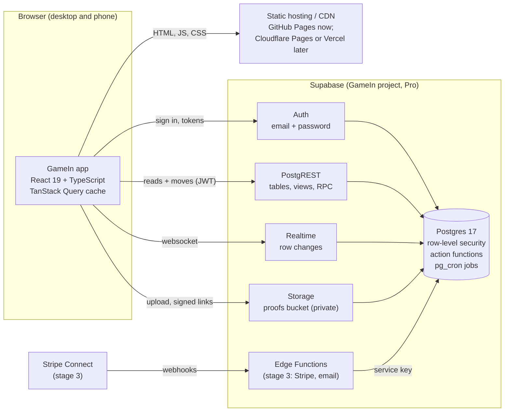
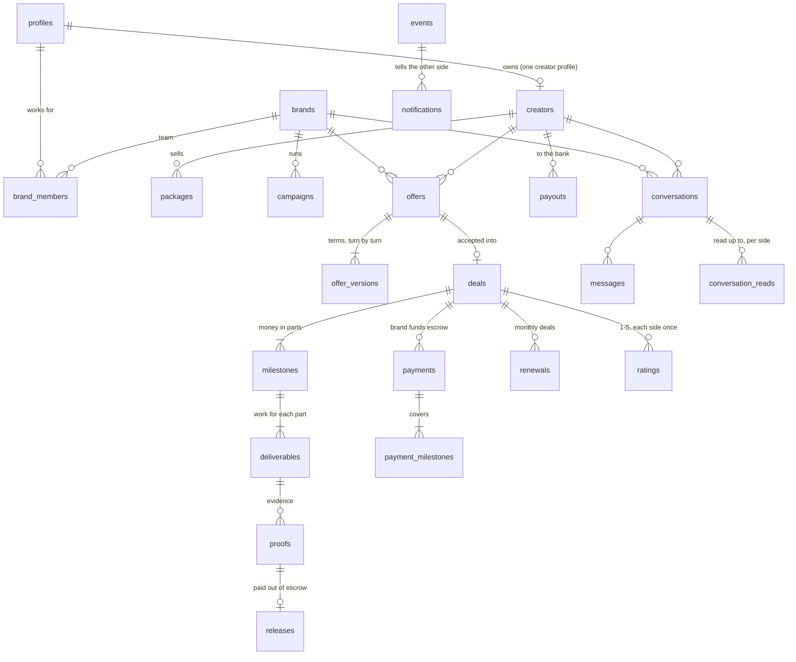
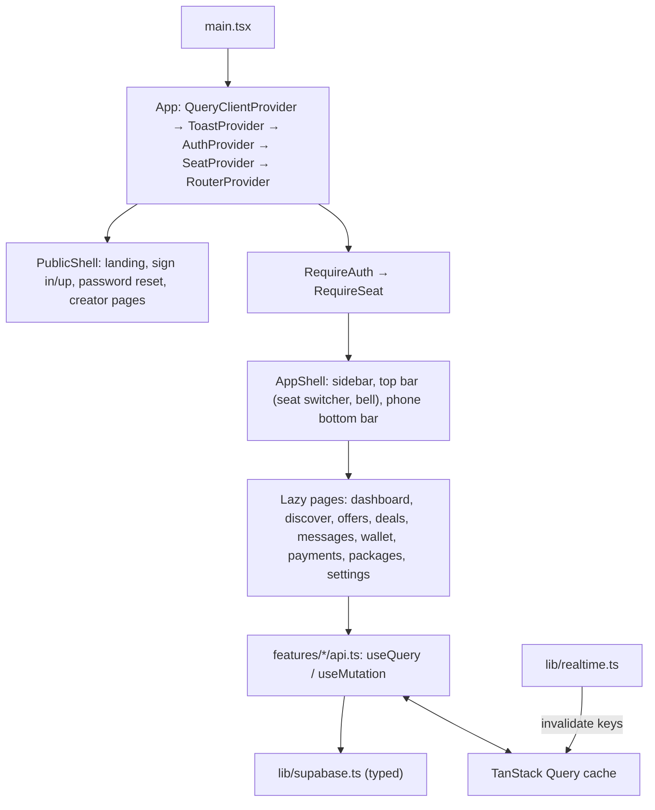

# GameIn architecture

GameIn is a two-sided sponsorship marketplace for gaming creators and brands. Brands send offers, creators accept,
the brand's money waits in escrow, the creator delivers proof, and the money is released when the brand approves.

This document describes the production app in `app/` and the backend in `supabase/` it runs on. The single-file
prototype at the repository root (`index.html`, with `live/`) stays online as the demo until the app replaces it.

## 1. System architecture



**The principles:**

- **The database is the backend.** Every rule about offers, deals and money lives in Postgres as a transactional
  function, with its rule id: O9 is "it's not your turn", E6 is "not in escrow yet". Two moves on one deal take
  turns. The ledger is double-entry and append-only. The app never computes money it then saves. It asks the
  database to make the move, and shows what the database says.
- **Row-level security decides who sees what.** The app uses the public, publishable key. Each request carries the
  signed-in person's token, and Postgres returns only their rows. Nothing secret ships to the browser.
- **The frontend is a static single-page app.** It's stateless and served from a CDN, so it scales without servers.
  The same build runs on GitHub Pages, Cloudflare Pages, Vercel or Netlify.
- **Server state lives in the query cache.** TanStack Query holds what each screen read. Realtime tells the app which
  rows changed, and the app refetches only the affected screens. There's no global client store to keep in sync.
- **Nothing is duplicated.** One function per move, one view per derived number (escrow, wallet, to-dos). Both sides
  of a deal always see the same figures.

### Request lifecycle: a brand approves proof

1. The brand presses **Approve & release** on the deal page.
2. `useApproveProof()` calls `POST /rest/v1/rpc/approve_proof { p_proof, p_undo_seconds: 6 }` with the brand's token.
3. Postgres locks the deal, checks the rules (party, proof in review, money in escrow), marks the proof as releasing,
   writes the event and notifies the creator, all in one transaction.
4. The app shows a 6-second undo bar. When it ends, the app calls `finalize_release`. The `release_due` job runs
   every 10 seconds and catches anything left over, for example if the tab closed.
5. Realtime sends the row changes to both people's browsers. Each app refetches its deal page, wallet and to-dos,
   and the creator's wallet shows the payout less the 5% fee.

## 2. Tech stack

| Layer | Choice | Why |
|---|---|---|
| UI | React 19, TypeScript 5.9 (strict) | Mainstream, typed end to end with the generated database types |
| Routing | React Router 7 (data router, lazy routes) | Code splitting per screen, URL is the state for navigation |
| Server state | TanStack Query 5 | Caching, deduping, background refetch, invalidation by key |
| Backend | Supabase: Postgres 17, PostgREST, Auth, Realtime, Storage | Already built and tested; RLS gives multi-tenant security in the database |
| Styling | CSS custom properties (design tokens) + component CSS | The prototype's look (Rajdhani, charcoal, mint), no runtime cost |
| Build | Vite 7 | Fast builds, small bundles, env handling |
| Tests | Vitest (unit), Playwright (end to end on desktop and phone) | The e2e tests run against Supabase's own stack in CI |
| CI/CD | GitHub Actions | Typecheck, lint, unit, build, e2e, deploy |

## 3. File structure

```
GameIn-version2/
├─ ARCHITECTURE.md              ← this document
├─ app/                         ← the production app
│  ├─ index.html                ← the page shell (fonts, meta)
│  ├─ vite.config.ts            ← base path, Content-Security-Policy for builds, test setup
│  ├─ playwright.config.ts      ← e2e: desktop + phone against a Supabase stack
│  ├─ .env.development          ← local Supabase CLI stack
│  ├─ .env.production           ← the hosted project (public URL + publishable key)
│  ├─ public/                   ← favicon, robots.txt
│  ├─ deploy/404.html           ← GitHub Pages' 404: sends deep links (/app/deals/…) back into the app
│  ├─ src/
│  │  ├─ main.tsx               ← boot: mounts <App/>
│  │  ├─ app/                   ← App (providers), routes, route guards, useAction (mutations + toasts),
│  │  │                            deepLink.ts (puts a deep link's path back before the router starts)
│  │  ├─ lib/                   ← framework-free modules
│  │  │  ├─ supabase.ts         ← the typed client
│  │  │  ├─ env.ts              ← the Supabase URL and key, the base path
│  │  │  ├─ db.ts               ← must/maybe/one: a response's data, or its error thrown
│  │  │  ├─ queryClient.ts      ← cache times, which errors are worth a retry
│  │  │  ├─ database.types.ts   ← generated from the database (supabase gen types)
│  │  │  ├─ types.ts            ← app types: Side, Seat, Item, row aliases
│  │  │  ├─ money.ts            ← cents, formatting, the fee formulas (mirror the database's)
│  │  │  ├─ items.ts            ← deliverables: parse, validate (mirror items_valid)
│  │  │  ├─ time.ts             ← relative time, countdowns, due dates
│  │  │  ├─ errors.ts           ← database refusals and auth errors → readable messages
│  │  │  ├─ keys.ts             ← query-key factory
│  │  │  ├─ realtime.ts         ← one channel per person → targeted invalidation, polling fallback
│  │  │  └─ storage.ts          ← proof uploads, signed links
│  │  ├─ features/              ← one folder per domain: api.ts (queries + mutations) and its screens
│  │  │  ├─ auth/               ← session provider, sign in/up, password reset
│  │  │  ├─ seats/              ← creator/brand seats, the seat switcher
│  │  │  ├─ onboarding/         ← create a creator profile or a brand
│  │  │  ├─ landing/            ← the public home page
│  │  │  ├─ dashboard/          ← to-dos, money, active deals
│  │  │  ├─ creators/           ← discover, public creator pages
│  │  │  ├─ brands/             ← brand lookup (for pitches)
│  │  │  ├─ packages/           ← a creator's packages
│  │  │  ├─ offers/             ← list, detail, new offer/pitch, counter
│  │  │  ├─ deals/              ← list, detail: funding, proof, approval, release, rating
│  │  │  ├─ messages/           ← conversations and threads
│  │  │  ├─ wallet/             ← creator balance, history, payouts
│  │  │  ├─ payments/           ← brand payments and escrow
│  │  │  ├─ notifications/      ← the bell, readable activity
│  │  │  └─ settings/           ← account, creator profile, brand
│  │  ├─ components/
│  │  │  ├─ ui/                 ← design system: Button, Field, Card, Badge, Tabs, Dialog, Toast, HexAvatar...
│  │  │  └─ layout/             ← AppShell (sidebar, top bar, phone bottom bar), PublicShell, PageHeader
│  │  ├─ assets/fonts/          ← Rajdhani and Michroma (OFL), served with the app
│  │  └─ styles/                ← tokens.css (the palette), base.css, ui.css, layout.css, pages.css
│  └─ tests/e2e/                ← Playwright specs: the deal flow, access, auth, seats, public pages
├─ supabase/                    ← the backend
│  ├─ migrations/               ← schema, helpers, actions, views, security (applied in order)
│  ├─ seed.sql                  ← demo accounts and deals
│  └─ config.toml               ← the local stack (Supabase CLI)
├─ db/tests/                    ← database tests (rules, money, races)
├─ .github/workflows/
│  ├─ app.yml                   ← app: check, e2e (desktop + phone), deploy to Pages
│  └─ database.yml, live.yml, tests.yml ← backend and prototype checks
└─ index.html, live/, tests/    ← the prototype and its live mode (until the app replaces them)
```

**Feature module rule.** A screen talks to the backend only through its feature's `api.ts`. Those hooks are the
app's API layer: queries with typed rows, and mutations that call one database function and invalidate the right
keys. Shared UI lives in `components/ui`, and nothing in `ui` knows about the database.

## 4. Database schema

Five migrations in `supabase/migrations/` (2,900 lines), tested by `db/tests` on Postgres 15, 17 and Supabase's own
image.



| Area | Tables | Notes |
|---|---|---|
| Accounts | `profiles`, `creators`, `brands`, `brand_members`, `platform_admins` | A person can hold a creator profile and any number of brand seats (owner, admin, member) |
| Marketplace | `packages`, `campaigns`, `campaign_shortlist` | Public: creators, brands, active packages, open campaigns |
| Negotiation | `offers`, `offer_versions` | Up to 8 counters; each reply restarts the window: 24 hours, 48 from a campaign, 72 for pitches |
| Deals | `deals`, `deal_periods`, `milestones`, `deliverables` | One milestone per deliverable; the amount is split to the cent |
| Money | `payments`, `payment_milestones`, `releases`, `payouts`, `ledger_entries` | Integer cents. 5% brand fee on funding, 5% creator fee on release, 1.5% for an instant payout. The ledger balances to zero per transaction and can't be edited |
| Evidence | `proofs` (+ the private `proofs` storage bucket) | One live proof per deliverable; files under `<deal id>/` |
| Conversation | `conversations`, `messages`, `conversation_reads`, `events`, `notifications` | Every move writes an event and notifies the other side |
| After the deal | `renewals`, `ratings` | |

**Enums:**

- `side`: brand, creator
- `offer_status`: sent, countered, accepted, declined, withdrawn, expired
- `deal_status`: awaiting_funding, in_progress, completed, cancelled
- `milestone_status`: pending, processing, awaiting_wire, in_escrow, released
- `deliverable_status`: upcoming, in_review, changes_requested, done
- `proof_status`: in_review, releasing, released, changes_requested
- `payment_method`: card, bank, wire
- `payment_status`: processing, awaiting_wire, succeeded, failed
- `payout_status`: pending, paid, failed

**Views** do the arithmetic with the reader's own rights (`security_invoker`):

- `my_seats`
- `offer_board`: the latest terms, who the offer waits on, and expired at once
- `deal_money`
- `brand_money`
- `creator_wallet`
- `wallet_lines`
- `todos`
- `conversation_timeline`

**Scheduled jobs** (pg_cron):

- `release_due` runs every 10 seconds. It releases approvals whose undo window has passed, and auto-approves proof
  left unreviewed for 5 days.
- `expire_offers` runs every minute.

## 5. API

The API is Supabase's: PostgREST over the schema, Auth, Storage and Realtime. All URLs are relative to
`https://<project>.supabase.co`. Every request sends `apikey: <publishable key>`. Signed-in requests also send
`Authorization: Bearer <access token>`.

### Auth (`/auth/v1`)

| Endpoint | Used for |
|---|---|
| `POST /signup` | Create an account (`{ email, password, data: { name } }`); a profile row is made by trigger |
| `POST /token?grant_type=password` | Sign in |
| `POST /token?grant_type=refresh_token` | Keep the session alive (automatic) |
| `POST /recover` | Email a password-reset link |
| `PUT /user` | Set a new password |
| `POST /logout` | Sign out |

### Reads (`GET /rest/v1/...`, row-level security applies)

| Endpoint | Screen |
|---|---|
| `my_seats` | Seat switcher, onboarding |
| `creators?select=*,packages(*)&or=(display_name.ilike.*q*,handle.ilike.*q*)` | Discover (public) |
| `creators?handle=eq.{handle}&select=*,packages(*)` | Creator page (public) |
| `brands?or=(name.ilike.*q*,slug.ilike.*q*)` | Pitch a brand |
| `packages?creator_id=eq.{id}` | My packages |
| `offer_board?{side}_id=eq.{seat}&select=*,brand:brands(name,slug),creator:creators(display_name,handle)` | Offers |
| `offer_board?id=eq.{id}` + `offer_versions?offer_id=eq.{id}` | Offer page and its history |
| `deal_money?{side}_id=eq.{seat}&select=*,brand:brands(...),creator:creators(...)` | Deals |
| `deals?id=eq.{id}&select=*,milestones(*),deliverables(*),proofs(*),ratings(*)` + `payments?deal_id=eq.{id}` | Deal page |
| `todos?side=eq.{side}&{side}_id=eq.{seat}` | Dashboard |
| `conversations?{side}_id=eq.{seat}&select=*,conversation_reads(*),brand:brands(name),creator:creators(display_name)` | Messages |
| `conversation_timeline?conversation_id=eq.{id}&order=at.desc&limit=200` | A thread |
| `creator_wallet?creator_id=eq.{id}`, `wallet_lines`, `payouts` | Wallet |
| `brand_money?brand_id=eq.{id}`, `payments?brand_id=eq.{id}` | Payments |
| `notifications?select=*,event:events(*,brand:brands(name),creator:creators(display_name))&order=id.desc&limit=30` | The bell |

### Moves (`POST /rest/v1/rpc/{function}`, one transaction each)

| Function | Who | Body |
|---|---|---|
| `create_creator_profile` | anyone signed in | `p_handle, p_display_name` |
| `create_brand` | anyone signed in | `p_name, p_slug?` |
| `send_offer` | brand | `p_brand, p_creator, p_title, p_amount_cents, p_items, p_note?, p_campaign?` |
| `book_package` | brand | `p_brand, p_package, p_note?, p_expected_price_cents?` |
| `pitch_offer` | creator | `p_creator, p_brand, p_package?, p_title?, p_amount_cents?, p_items?, p_note?` |
| `counter_offer` | the side it waits on | `p_offer, p_as, p_amount_cents, p_note?, p_items?` |
| `accept_offer` / `decline_offer` | the side it waits on | `p_offer, p_as` (+ `p_reason`) |
| `withdraw_offer` | the side that sent the latest version | `p_offer, p_as` |
| `fund_milestones` | brand | `p_deal, p_method (card/bank/wire), p_scope (next/all)` or `p_milestones` |
| `simulate_payment` | brand, simulated payments only | `p_payment, p_outcome (cleared/failed)` |
| `submit_proof` | creator | `p_deliverable, p_link_url?, p_file_path?, p_note?` |
| `approve_proof` / `undo_approval` / `request_changes` | brand | `p_proof` (+ `p_undo_seconds` / `p_note`) |
| `finalize_release` | either party | `p_proof` |
| `rate_deal` | either party, once the deal is complete | `p_deal, p_as, p_score (1-5), p_comment?` |
| `book_again` | creator, after a completed deal | `p_deal, p_note?` |
| `send_message` / `mark_read` | either party | `p_brand, p_creator, p_as, p_body` / `p_conversation, p_as, p_upto_seq?` |
| `mark_notifications_read` | anyone | `p_ids?` |
| `request_payout` | creator | `p_creator, p_amount_cents?, p_instant?` |
| `offer_renewal`, `request_renewal`, `answer_renewal`, `withdraw_renewal` | monthly deals | (in the database; screens come after the MVP) |

**Refusals.** A refused move answers `400` with a readable `message`, and the rule id in `hint`. The app shows the
message as is.

**Backend only (service key):** `confirm_payment`, `fail_payment`, `complete_payout`, `release_due`, `expire_offers`.
With Stripe these will be called by Edge Functions:

- `POST /functions/v1/stripe-webhook`
- `POST /functions/v1/create-payment` (PaymentIntent for a funding)
- `POST /functions/v1/connect-onboarding` (creator payout accounts)

### Direct writes (`POST`/`PATCH /rest/v1/{table}`, limited columns)

- `profiles`: display_name, avatar_url
- `creators`: handle, display_name, bio, avatar_url, platforms
- `brands`: name, logo_url (owners and admins)
- `packages`: insert and update your own

### Storage and Realtime

- `POST /storage/v1/object/proofs/{deal id}/{file}`. Only the deal's creator can upload, and nobody can overwrite.
- `POST /storage/v1/object/sign/proofs/{path}` makes a link that expires after an hour, for either party only.
- `wss://.../realtime/v1/websocket`: `postgres_changes` on 15 tables, filtered by row-level security.

## 6. UI architecture



**Seats.** The signed-in person acts as one seat at a time: their creator profile or one of their brands. The seat
lives in `SeatProvider` and is remembered per browser. Every query includes it in its key, so switching seats shows
the other side's data without a reload.

**Routes:**

| Path | Screen | Who |
|---|---|---|
| `/` | Landing | public (signed-in people go to `/dashboard`) |
| `/sign-in`, `/sign-up?role=`, `/forgot-password`, `/reset-password` | Auth | public |
| `/c/:handle` | Creator page with packages | public |
| `/onboarding` | Create a creator profile or a brand | signed in |
| `/dashboard` | To-dos, money, active deals | both seats |
| `/discover` | Find creators | both (booking needs a brand seat) |
| `/offers`, `/offers/new`, `/offers/:id` | Negotiation | both |
| `/deals`, `/deals/:id` | Escrow, proof, approval, release, rating | both |
| `/messages`, `/messages/:id` | Conversations | both |
| `/packages` | My packages | creator |
| `/wallet` | Balance, history, payouts | creator |
| `/payments` | Escrow and payments | brand |
| `/settings` | Account, creator profile, brand | both |

**Live updates:**

- `lib/realtime.ts` opens one channel per signed-in person and maps each changed row to the query keys it affects.
  For example, a `proofs` row invalidates `['deal', deal_id]`, the deal lists, the to-dos and the wallet. Only the
  screens on show refetch.
- If Realtime can't connect, active screens refetch every 5 seconds until it's back.
- The notification bell checks every 30 seconds as a safety net. The app also refetches when the tab comes back
  into view.

**Design system.**

- `styles/tokens.css` carries the prototype's palette: charcoal `#26282b`, surfaces `#3c4044`, mint `#5ce5b0`,
  coral `#ea7171`.
- Type is Rajdhani, with small uppercase letter-spaced labels. Corners are 4 to 8 px.
- Components are plain React with class names (`g-btn`, `g-card`, …). They're accessible: labels on every field,
  focus rings, `aria-live` toasts, dialogs that trap focus and close on Escape.
- Layouts are responsive. On a computer there's a sidebar and a top bar; on a phone, a top bar and a bottom bar with
  the four main places plus More. Wide tables turn into labelled rows on a phone instead of scrolling sideways.

**Deep links on a static host.** GitHub Pages answers an unknown path with the site's `404.html`. Ours sends
`…/app/deals/123` to `…/app/?redirect=/deals/123`, and `app/deepLink.ts` restores the path before the router reads
it, so links from emails and notifications open the right screen. Hosts with rewrites (Cloudflare Pages, Vercel)
serve `index.html` directly and skip that hop.

## 7. Security

- Row-level security on every table. The app holds no secrets: the publishable key is public by design.
- Every move is a security-definer function that checks the actor's seat (`assert_acting`) and the rule, and locks
  rows in a fixed order.
- Text is rendered by React, so it's always escaped. There's no `dangerouslySetInnerHTML`.
- Proof links must be http(s); the database refuses anything else. Files are private and opened through links that
  expire.
- The production build ships a Content-Security-Policy:
  - scripts from the app's own origin only;
  - connections only to the Supabase project (HTTPS and its websocket);
  - fonts and styles from the app itself (the fonts are self-hosted; nothing loads from a third party).
- Sessions use Supabase Auth: short-lived access tokens, refreshed automatically, stored by supabase-js. Password
  reset goes through Supabase's own email links.

## 8. Scaling plan

| When | Change |
|---|---|
| Now | Static app on a CDN, Supabase Pro. Queries are scoped to one seat and paged (creators 24 at a time, threads 200 messages, notifications 30) |
| ~1k active people | Move hosting to Cloudflare Pages or Vercel, for headers (HSTS, frame-ancestors) and preview deploys. Add Sentry, plus index review with `pg_stat_statements` |
| ~10k | Supavisor pooling for PostgREST. Search on `pg_trgm` indexes (creators, brands). Cursor pagination on lists. CDN caching of public creator pages |
| Money goes real | Stripe Connect through Edge Functions (`payments_provider = 'stripe'`). Webhooks call `confirm_payment` / `complete_payout`. A custom SMTP sender, then email confirmation back on |
| ~100k | Read replicas for public pages and search. Move notification fan-out to a queue (pgmq). Split analytics to a warehouse |

The rules stay in one place, the database, so new clients can be added without re-implementing them: a mobile app, a
brand API, admin tools.

## 9. Testing and delivery

- **Database**: `db/tests` checks every rule, the money arithmetic, and races (two tabs approving at once) on three
  Postgres versions.
- **App unit tests** (Vitest) cover money formatting and the fee formulas (checked against values computed by the
  database's own functions), deliverables validation, error messages, time formatting, the realtime key map, activity
  lines, proof file names, offer turns, and the deliverables editor.
- **App end to end** (Playwright) runs on desktop and phone against the Supabase CLI stack with the migrations and
  seed. Two new people in two browsers:
  - sign up and onboard; a package, a booking, a counter that arrives live, acceptance;
  - escrow funding by card with the 5% fee, proof as a link and as a file (opened through a signed link);
  - approval, undo, approval again, release; both ratings; messages both ways, live;
  - the creator's wallet and a payout.

  Plus: what an outsider can't see (row-level security), sign-in redirects back to the page asked for, joining
  twice with one email, a wrong password, switching seats, and the public pages.
- **CI** (`.github/workflows/app.yml`) runs on every push and pull request:
  1. typecheck, lint, unit tests, build;
  2. e2e (desktop and phone, side by side);
  3. on `main`, publish to GitHub Pages: the prototype at the root as before, the app under `/app/`. This needs
     Settings → Pages → Source set to "GitHub Actions" once; until then the step is skipped with a note.
