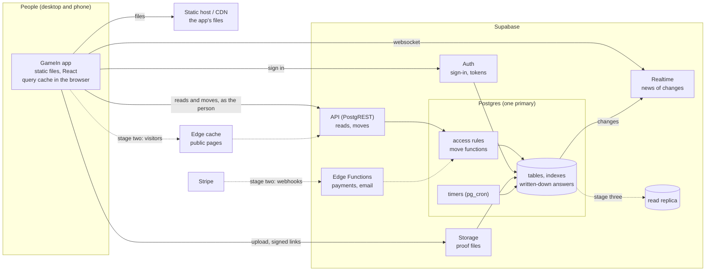
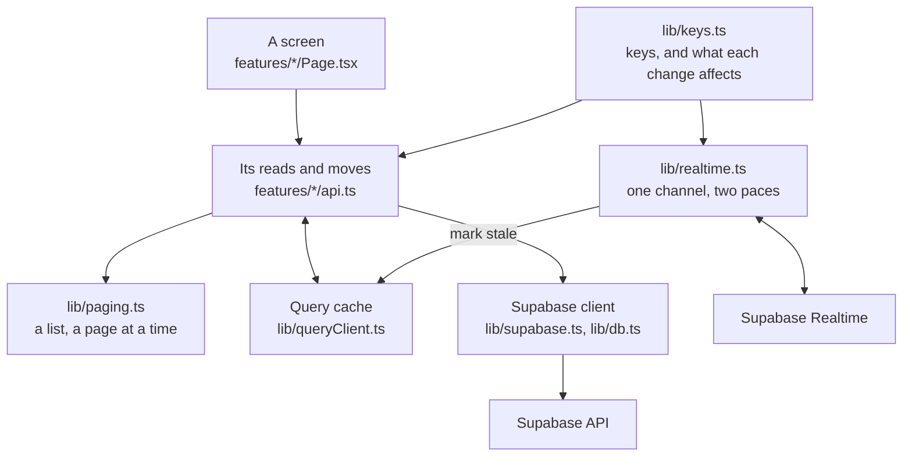
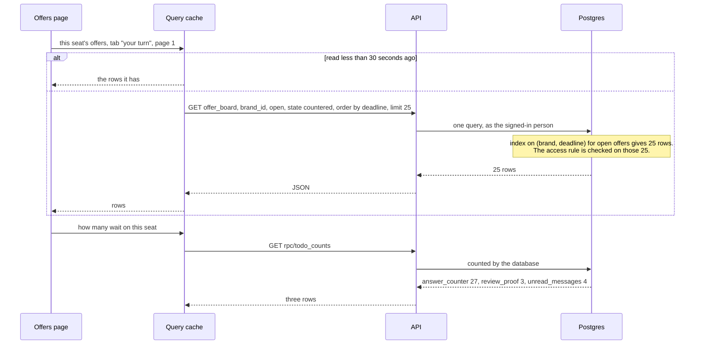
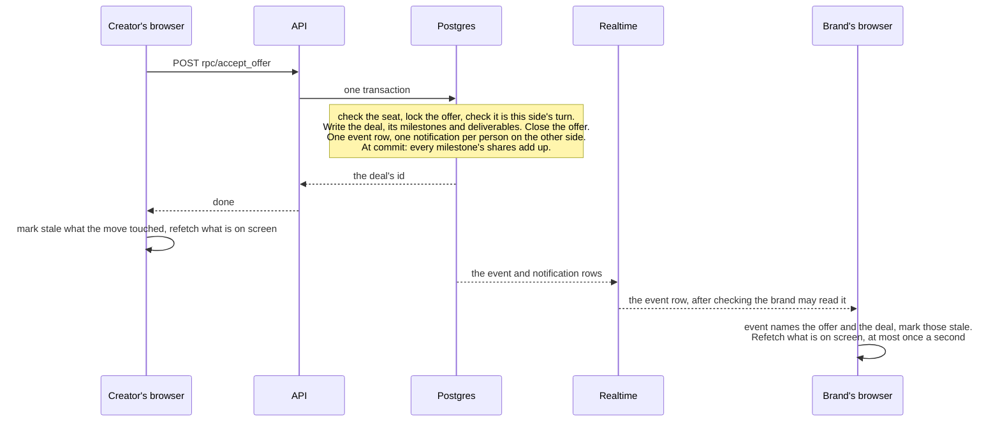
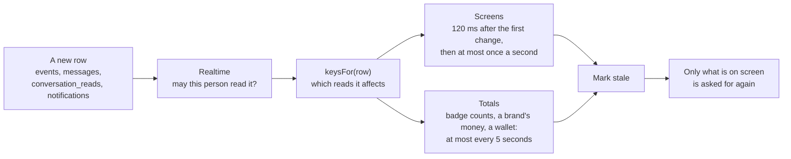

# GameIn system design

How GameIn holds up as it grows: what the system has to do, how it is put together so that it can, what was
measured, what is built now (stage one) and what comes after it, and when.

[ARCHITECTURE.md](ARCHITECTURE.md) describes the app and the backend as they are: the files, the tables, every API
call, every screen. This document is about size. Every measurement in it comes from [db/bench](db/bench/README.md),
which grows a copy of GameIn to 200,000 creators and measures each screen's requests on it; the full tables are in
[db/bench/RESULTS.md](db/bench/RESULTS.md).

1. [The short version](#1-the-short-version)
2. [What the system has to do](#2-what-the-system-has-to-do)
3. [Architecture](#3-architecture)
4. [Component structure](#4-component-structure)
5. [Data flow](#5-data-flow)
6. [API design](#6-api-design)
7. [Database schema](#7-database-schema)
8. [Caching strategy](#8-caching-strategy)
9. [What was measured](#9-what-was-measured)
10. [The stages](#10-the-stages)
11. [Running it](#11-running-it)
12. [Where it is in the code](#12-where-it-is-in-the-code)

## 1. The short version

GameIn is small today (November 2026): 6 creators, 6 brands, 5 deals, a 19 MB database. Everything is instant. The question for a
design is what the same system does with 200,000 creators and a million offers, and what has to be true of it for
the answer to be "the same as today".

So a copy was grown to that size, and every request every screen sends was measured on it. What gave way first:

| What gave way | Measured on the big database |
|---|---|
| Every screen got slower for everyone, because finding one person's rows meant going through everyone's | An ordinary brand's dashboard read 100,000 pages of the database (800 MB) to show 13 deals |
| The busiest accounts stopped working | Their offers and messages ran into the API's 8-second limit. Their badge counts and money figures were worked out from answers cut off at 1,000 rows, and nothing said so |
| A job that runs every 10 seconds read every proof ever submitted | One second of work, 400,000 page reads, every 10 seconds |
| A few people at once were enough to fill it | 16 people: 3.6 screens a second, 1 screen in 20 took over 10 seconds, requests failed |
| A safety check on money wasn't checking | The check that a ledger posting balances ran with the signed-in person's access, saw no rows, and passed |

One rule answers the first four: **a request costs what it shows.** A screen that shows 25 offers reads about 25
offers' worth of the database, whoever asks and however big GameIn is. Stage one applies that rule to everything
every screen does, and is built: one migration and the app that goes with it.

| | Before | Stage one |
|---|---|---|
| An ordinary brand's dashboard | 228 ms, 101,250 pages | 6 ms, 1,375 pages |
| The busiest brand's offers | fails (over 8 s) | 5 ms |
| The busiest brand's messages | fails (over 8 s) | 6 ms |
| A creator's public page | 111 ms, reads all 200,000 creators | 3 ms |
| Accepting an offer | 0.5 to 0.9 s | 14 ms |
| The 10-second job | 1.0 s, 409,218 pages | 1 ms, 3 pages |
| 16 people at once | 3.6 screens a second, 95 in 100 under 10.5 s, 13 requests failed | 127.5 screens a second, 95 in 100 under 272 ms, none failed |
| Answers cut off at 1,000 rows | badge counts and money figures | none |

Three costs still grow after stage one. None grows with GameIn; each grows with one account, one conversation or
one crowd, and each has a stage-two answer and a number that says when ([section 10](#10-the-stages)):

- **A very large account's totals.** A brand's money and a creator's wallet are still added up from every deal the
  account ever had: 0.4 s for a brand with 18,685 deals, a few milliseconds for an ordinary one.
- **Live updates.** Supabase checks each change against each person listening. Stage one cut what is listened to
  from fifteen tables to four; past a few hundred people online it needs a different mechanism.
- **Public pages.** Each visit to a creator's page is a read of the database: 3 ms now, but nothing stands between
  a crowd and the database yet.

## 2. What the system has to do

### The product

A two-sided marketplace. A brand sends a creator an offer (or a creator pitches); they counter until one accepts;
the offer becomes a deal with milestones; the brand funds escrow; the creator delivers proof; the brand approves;
the money is released to the creator's wallet, less fees; the creator pays out. Both sides message throughout, and
each sees what waits on it.

### The shape of the load

- **Reads far outnumber moves.** A deal is about twenty moves spread over weeks. Every screen opened is three to
  nine reads, and every move by one side refreshes the other side's screens. The design is about reads.
- **Accounts are very unequal.** Most brands have a dozen deals; an agency has thousands. The benchmark signs in
  as seven people, from someone who joined today to a brand with 36,886 offers and 18,685 deals. The ordinary
  accounts say what most people feel. The busy ones say what breaks first.
- **A request's cost can depend on three sizes:** what it shows (a page of 25), the account (its 18,685 deals), or
  all of GameIn (a million offers). The first is the goal. The second is acceptable for a while, and only for
  totals. The third is what the system had everywhere, and it is the one that sinks it.
- **Moves are small and independent.** A move locks one offer or one deal, writes a handful of rows and one event.
  Two moves on different deals never wait for each other. One database server takes hundreds of these a second;
  a marketplace this size makes a few.

### Targets

The design is held to these. The first four are measured by the benchmark.

| | Target | Stage one |
|---|---|---|
| A screen | Under 200 ms, on any account | Met by every list and every ordinary account: 2 to 12 ms. Not yet by the totals of an account with thousands of deals: 0.1 to 0.4 s (stage two) |
| A move | Under 100 ms | Met: 2 to 23 ms |
| Growth | Ten times the accounts doesn't change what one account's screen costs | Met: no request reads a whole table any more |
| A request that can't be answered | Shows an error. Never a partial answer that looks whole | Met: nothing relies on the API's 1,000-row cap |
| News from the other side | On screen about a second after it happens; totals within five | By design (section 5). Realtime's own delay isn't in the benchmark |
| Money | Never wrong: integer cents, one transaction per move, a ledger that balances, the same figure on both sides | As before, and the checks at commit now check (section 7) |

### The budget

Time on a test machine with everything in memory flatters a design. The honest measure is **pages**: how many
8 kB pages of the database a request touches, counting a page each time it is visited. It is the same on any
machine, and it is what turns into disk reads when the database is bigger than memory.

GameIn runs on Supabase's smallest paid server (Micro: 1 GB of memory, a disk that sustains about 500 reads a
second). A dashboard that touches 100,000 pages can't be served from 1 GB of memory once the database is 7 GB; from
disk it is minutes of reading, and the API gives up at 8 seconds. So the budget for a screen is **a few thousand
pages at most, and a number that doesn't move when GameIn grows.**

| Supabase compute | Memory | CPU | Database connections | Disk reads a second, sustained |
|---|---|---|---|---|
| Micro (today) | 1 GB | shared | 60 | 500 |
| Small | 2 GB | shared | 90 | 1,000 |
| Medium | 4 GB | shared | 120 | 2,000 |
| Large | 8 GB | 2 cores | 160 | 3,600 |

XL and 2XL double memory and cores again (16 GB and 4 cores, 32 GB and 8). Source:
[Supabase compute and disk](https://supabase.com/docs/guides/platform/compute-and-disk).

## 3. Architecture

Solid lines are built. Dashed lines are the later stages.

### The principles

1. **The database is the backend.** Every rule about offers, deals and money is a Postgres function that makes one
   move in one transaction. Every read goes through row-level security as the signed-in person. There is no
   application server to write, run, secure or scale, and no second place where a rule could differ.
2. **The app is static files.** It holds no secrets and has no server of its own, so it scales by being copied to
   a CDN.
3. **A request costs what it shows.** Every list names its seat, comes a page at a time in an order the database
   has an index for, and every count on screen is counted by the database. An access rule checks the rows a
   request found; it is never how the rows are found.
4. **An answer that would be expensive to work out is written down when the fact happens,** in the same
   transaction, by the database. Stage one does this for unread messages; stage two does it for money totals.
   Nothing is written down that can't be checked against the rows it came from, and the tests check it.
5. **The app refreshes at a bounded pace.** However fast changes arrive, an open tab asks again at most once a
   second for what's on screen and once in five for totals. The load an account puts on the database is set by
   how many tabs it has open, not by how busy it is.

### Why this shape, and what was weighed against it

| Chosen | Instead of | Because | Revisit when |
|---|---|---|---|
| Rules as Postgres functions behind PostgREST | An application server between the app and the database | One place for the rules and the money. One transaction per move. Access rules guard every read whichever client asks. Nothing extra to run | Work has to leave the database: card payments, email, webhooks. Those go to Edge Functions (stage two), which call the same functions |
| One Postgres database | A database or service per area (deals, messages, money) | A move changes a deal, its money, a message line and a notification together, in one transaction. A million offers is 8 GB | Reads outgrow one server (replicas), or the logs outgrow memory (partitions): stage three |
| The browser's query cache, kept fresh by Realtime | A shared cache server in front of the database | Nearly every read is one person's own rows, so there is little to share between people. The browser already holds what the person saw | Public pages, which are the same for everyone: an edge cache (stage two) |
| Postgres indexes for search (trigrams) | A search service | 200,000 creators: 3 to 16 ms | Search needs ranking, typo tolerance or filters by audience (stage three) |
| Two timers in the database (pg_cron) | A queue and workers | Two jobs, each found by index in about a millisecond | Notifications fan out to email and push (stage three) |

### What scales how

| Part | State it holds | Scales by | First limit | Then |
|---|---|---|---|---|
| App in the browser | A copy of what its screens read | One per person | none | |
| Static host | Files | CDN | none in practice | |
| Auth | Sessions | Supabase runs it | Its own rate limits on sign-in | |
| API (PostgREST) | None; a pool of connections | Supabase runs it | Database connections: 60 on Micro, 160 on Large | The pooler; larger compute |
| Postgres | Everything | Larger compute, then read replicas | Memory for the indexes; CPU for reads; one server writes | Stage three |
| Realtime | Connections and what each listens to | Supabase runs it | 500 connections on Pro with the spend cap, 10,000 without. Each change is checked against each listener, on one thread | Broadcast (stage two) |
| Storage | Proof files | Supabase runs it (S3) | none in practice | |
| Timers | None | Run in the database | A run has to finish before the next starts | Found by index (done) |

Sources for the Realtime limits:
[Realtime limits](https://supabase.com/docs/guides/realtime/limits),
[Postgres Changes](https://supabase.com/docs/guides/realtime/postgres-changes).

## 4. Component structure

### In the browser

| Module | What it is responsible for |
|---|---|
| `features/*/api.ts` | The only place that talks to the backend. One hook per read or move. A read names its seat, its page and its order; a move calls one database function and marks stale what it changed |
| `lib/paging.ts` | `usePagedList`: a list read 25 rows at a time, "show more" for the next page. Pages never overlap or leave a gap, because every order ends in a unique column |
| `lib/keys.ts` | The cache's vocabulary: the key of each read, and `affected`: which keys one change touches. Moves and Realtime both use it, so the person who moved and the person watching refresh the same things |
| `lib/realtime.ts` | One Realtime channel per person on four tables. Turns each row that arrives into the keys it affects and marks them stale at a bounded pace. Falls back to asking every 5 seconds when Realtime is down |
| `lib/queryClient.ts` | How long each kind of data stays fresh, and which failures are worth asking about again (a read the database stopped at its time limit is not) |
| `lib/db.ts` | A response's rows, or its error thrown with its HTTP status; `counted` for requests that only count |

### In the database

| Layer | What is in it | Runs as |
|---|---|---|
| Tables | The rows: accounts, offers, deals, money, messages, the event log. Constraints hold what must always be true of one row | |
| Helpers (`private`) | Whose seats the person has, locks, the ledger posting, the event log. Not reachable from the API | |
| Move functions (`public`, `rpc/…`) | One per move: check the seat, lock the offer or deal, check the rule, write, log one event | The database's owner, after checking who is asking |
| Views and read functions | The arithmetic every screen shares: a deal's money, what waits on a seat, counts, search | The person asking: access rules apply |
| Access rules (row-level security) | Which rows a person may read. Checked on every row any request finds | |
| Triggers | Checks at commit (a ledger posting balances, a milestone's shares add up), and the record of unread messages | The database's owner |
| Timers (pg_cron) | `release_due` every 10 seconds, `expire_offers` every minute | The database's owner |

### What is the truth, what is derived, what is a copy

| State | Where | Kind |
|---|---|---|
| Offers, deals, milestones, proofs, payments, messages | Postgres tables | The truth |
| Every money movement | `ledger_entries`: double entry, append-only | The truth for money; the audit compares everything else with it |
| What happened, in order | `events` | The truth; also what Realtime carries |
| Which messages a side hasn't read | `unread_messages` | Derived, written in the same transaction as the message or the read mark |
| A deal's money, a brand's money, a wallet, what waits on a seat | Views | Derived, worked out when read (written down in stage two) |
| What a screen last read | The browser's query cache | A copy, refreshed by Realtime and by the person's own moves |
| The chosen seat, a message not sent yet | The browser's storage | The person's own |
| Proof files | Supabase Storage | The truth, private, opened through links that expire |

## 5. Data flow

### A read: the offers page

What makes it cost what it shows:

- **The request names its seat** (`brand_id=eq.…`). The index is keyed by seat, so the database goes straight to
  this seat's rows.
- **The filter is on stored columns.** `closed_at is null` is the index's own condition, so the index holds only
  the seat's open offers; the state (`raw_status`) is checked on those as they are read. The view's computed
  `status` ("expired" once the window passes) is shown, never filtered by.
- **The order is the index's order**, ending in a unique column, so the database reads 25 rows and stops.
- **The access rule is one check per row found.** For an offer: is its brand or its creator one of my seats. For
  anything under a deal, an offer or a conversation: is that one parent visible.
- **The count is its own request**, counted by the database. The list isn't fetched to be counted.

### A move: accepting an offer

- **One transaction.** Either the offer is accepted, the deal exists and both sides are told, or nothing happened.
- **One lock.** The move locks its offer (later moves lock their deal). Two people moving on the same deal take
  turns; moves on different deals don't meet. The job that releases money takes its locks in deal order, so two
  runs can't deadlock.
- **A fixed number of rows.** Whatever the accounts' size, a move writes its own rows, one event, a notification
  per person told, and at most one unread row. Its cost doesn't grow with anything.
- **One event row is the news.** It names the offer or deal it was about. That row is all Realtime has to carry
  for the other side's screens to know what to refresh.

### News from the other side

- **Four tables, not fifteen.** Every move writes one event row in the same transaction as the rows it changes.
  The app used to listen to each of those tables. Supabase checks every changed row against every listener, so
  one release, which changes seven rows, cost seven checks per person online. Now it costs one for the event row
  and one for each notification row.
- **Two paces.** The first change refreshes the screen 120 ms later (one move changes several rows; they are
  gathered). While changes keep arriving, the screen refreshes at most once a second and the totals at most every
  five seconds. Nothing is dropped: what arrives between two refreshes waits for the next. A person's own move
  refreshes everything it touched at once.
- **Three nets under it.** If Realtime can't connect, the screens on show ask again every 5 seconds until it can,
  then once more to catch up. The bell is asked for on a timer (every 30 seconds without Realtime, every two
  minutes with it) and refreshes the screens if it finds news Realtime didn't bring. Coming back to the tab asks
  again.

### Unread messages: an answer written down when the fact happens

"Which of my conversations have something I haven't read" used to be worked out on every page, for the badge in
the navigation: for each conversation the seat ever had, find how far it has read, then look for a later message.
It grows with the account, and no index can answer it, because the two halves sit in different rows written by
different people.

So it is recorded as it happens. Sending a message adds one row to `unread_messages` for the other side. Reading
a conversation removes that side's rows up to where it read. The badge is "the rows with my seat on them".

- The sender never touches a row the reader writes, and the reader only removes rows it can already see. Opening a
  thread never waits for a message that is being sent.
- The table can only be written by those two triggers. Nobody, not even the service key, can insert into it.
- It is checked against the messages and read marks themselves after every random walk in the database tests.

### Money

The brand funds a deal's milestones (card, bank or wire) → the money is in escrow → the creator's proof is approved →
after the undo window, the release moves the amount to the creator's wallet, less the creator fee → the creator
asks for a payout. Every step posts one balanced set of entries to the ledger through one function, and a check at
commit refuses a transaction whose entries don't sum to zero. The figures on screen (a deal's money, a brand's, a
wallet) are views over the same rows, so both sides can't see different numbers.

### Timers

`release_due` runs every 10 seconds: it releases approvals whose undo window has passed, and approves proof left
unreviewed for five days. `expire_offers` runs every minute. Each asks an index for what is due, and almost always
finds nothing: about a millisecond.

## 6. API design

The API is the database, served by Supabase: PostgREST over the tables, views and functions, plus Auth, Storage
and Realtime. Every call is listed in [ARCHITECTURE.md, section 5](ARCHITECTURE.md#5-api). This section is the
rules the calls follow, and why.

### Three kinds of call

| Kind | Shape | Guarded by |
|---|---|---|
| A read | `GET /rest/v1/{table or view}` or `GET /rest/v1/rpc/{read function}` | Row-level security, as the signed-in person |
| A move | `POST /rest/v1/rpc/{verb_noun}`: one function, one transaction | The function checks the seat and the rule; a refusal is `400` with a readable message and the rule's id |
| A direct write | `POST` or `PATCH` on a few tables (a profile, a package), limited columns | Row-level security and column grants |

### The contract for reads

Every read the app sends follows these. A request that breaks one works on a small database and fails on a big
one, so the benchmark is where it shows.

1. **Name the seat or the parent.** `brand_id=eq.`, `creator_id=eq.`, `deal_id=eq.`, `offer_id=eq.`,
   `conversation_id=eq.` or `id=eq.`. Never "everything I may see". Access rules decide what a person may read;
   they are not a way to ask for it.
2. **Ask for a page.** `limit` of 25 (24 creators, 20 to-dos, 200 lines of a thread). Nothing relies on the API's
   own cap of 1,000 rows, because that cap cuts an answer off without saying so.
3. **Give an order that ends in a unique column**, and that an index has: `created_at desc, id desc`. Pages then
   never overlap or skip, and the database stops reading when the page is full.
4. **Filter on what is stored.** A view's computed column (`status` that turns to "expired", `waiting_on`) is for
   showing. The filter uses the stored columns under it (`raw_status`, `closed_at`).
5. **Counts come from the database.** `rpc/todo_counts`, or a `HEAD` request with `Prefer: count=exact` on an
   indexed filter. Never the length of a list that was fetched.
6. **Children come with their parent.** A deal's milestones, deliverables and proofs are embedded in the request
   for that deal. A list of deals is followed by one request for the money of exactly the deals on the page.
7. **Search is its own request.** `rpc/search_creators`, `rpc/search_brands`: the text, a limit of at most 100, an
   offset. They return ordinary rows, so the usual `select`, embeds and order apply on top.

### What stage one changed

| Screen | Before | Now |
|---|---|---|
| Badges in the navigation | `todos` for the seat, counted in the app (wrong past 1,000) | `rpc/todo_counts?p_side=&p_seat=` |
| Dashboard to-dos | All of `todos` | `todos?…&limit=20`, with the count for "and 7 more" |
| Offers | The latest 200 offers, split into tabs in the app | One request per tab: `closed_at=is.null&raw_status=eq.…&order=expires_at,id`, or `closed_at=not.is.null&order=closed_at.desc,id.desc`. The closed tab is asked for when opened |
| Deals | The latest 200 deals, then the money of every deal the seat has | One page per tab by `status`, then `deal_money?deal_id=in.(the page's ids)`; the tab's count as `HEAD` |
| Dashboard: deals to fund | Worked out from every deal | `deals?…&milestones.status=eq.pending&select=…,milestones!inner(id)&limit=20` |
| Dashboard: ready to deliver | `deliverables` filtered through its deal (read every deliverable on GameIn) | `ready_deliverables?creator_id=eq.…&limit=20` |
| Messages | The latest 100 conversations | A page of 25, latest first |
| A thread | The newest 200 lines; earlier ones couldn't be reached | The newest 200; "show earlier" asks for 200 more |
| Wallet history, payments | The latest 100 | Pages of 25 |
| Discover | An `ilike` filter on the directory (read every creator) | `rpc/search_creators?p_q=text` |
| The bell | Every 30 seconds | Every 2 minutes while Realtime is connected |

### Pages

Pages are asked for by offset (`offset=25&limit=25`). That is right for lists people read from the top: page 2 of
a seat's offers costs the same as page 1. It is wrong for going deep: page 200 of the creator directory touches
22,525 pages (31 ms), because the database walks past 4,776 creators to get there. Stage two changes the directory
and threads to "the 24 after this one" (keyset), which costs the same at any depth.

### Limits, and what the app does at each

| Limit | Where | What the app does |
|---|---|---|
| 1,000 rows an answer | The API | Never gets near it: every list asks for a page |
| 8 seconds a request (3 for a visitor) | The database, per role | Shows "couldn't load" and a "try again". It does not ask again by itself: a read stopped at the limit would be stopped again, and two automatic retries were sixteen more seconds of the database's time from every tab that hit it |
| A request that never got an answer, or "busy" (503) | The network, the gateway | The Supabase client retries three times. The app doesn't retry on top of that |
| A refused move (`400`, the rule's id in `hint`) | A move function | Shows the database's message as it is. Moves are never retried |
| The API's pool of database connections | The API server (Postgres itself allows 60 on Micro) | A request holds one for a few milliseconds. Before stage one, 16 people were enough to use them up in the test: requests waited ten seconds for a free one and failed |

### Changing the API

The API's surface is the views, the functions and the tables' columns. `app/src/lib/database.types.ts` is generated
from it, so a screen that asks for something that isn't there doesn't compile.

- **Add, don't change.** A migration adds columns (at the end of a view), views, functions and indexes. It doesn't
  rename or remove anything a published app reads. The app that is live keeps working on the migrated database.
- **The database goes first, the app second.** A new app on the old database asks for things that aren't there.
  The deploy checks this instead of trusting anyone to remember ([section 11](#11-running-it)).
- **Remove a release later.** Once no published app reads something, a later migration can drop it.

### Still to come

- **Rate limits** on the moves that can be abused (sending offers, pitches, messages): a per-seat count inside the
  move function, found by index. Sign-in has Supabase's own limits already.
- **Payments that can arrive twice**, with Stripe: a webhook delivered twice must fund once. `confirm_payment`
  already does nothing the second time; the function that starts a payment needs a key to tell a retry from a new
  one.
- **Keyset pages** for the directory and threads.

## 7. Database schema

The tables and what they are for are in [ARCHITECTURE.md, section 4](ARCHITECTURE.md#4-database-schema). Stage one
is one migration, [`20261110000100_scale.sql`](supabase/migrations/20261110000100_scale.sql). It changes no rule
and no figure on any screen. It adds:

| Added | What it is |
|---|---|
| `unread_messages` | One row per message the other side hasn't read: `(conversation_id, to_side, seq)`, with the conversation's `brand_id` and `creator_id` so a seat's unread rows are found by index |
| `todo_counts(side, seat)` | How many things of each kind wait on a seat |
| `ready_deliverables` | A creator's work that is funded and not delivered, found from the creator's running deals |
| `search_creators`, `search_brands` | Name or handle contains the text, in name order, a page at a time |
| `offer_board.raw_status`, `deal_money.created_at` | The stored state and date the lists filter and sort by |
| 25 indexes (5 older ones dropped) | One for each question a screen asks, below |
| Rewritten access rules | The same people see the same rows; each row is checked against its own parent |

### Two facts about row-level security that shape everything

Both were measured, not assumed.

1. **A request's filter can only steer an index if Postgres trusts the comparison not to leak.** Equality on a
   uuid, a number, a date or text is trusted. Comparing an enum (a status) and `LIKE` are not. So on a table with
   access rules, "this seat's offers in this state" can't be an index on `(seat, status)`: the status would be
   checked after the access rule, row by row. The state goes into the index's own condition instead (a partial
   index), which Postgres may always use, and an `is null` test always can.
2. **An access rule checks rows. It never finds them.** However the rule is written, Postgres applies it to each
   row a request has already found by other means. A request that names nothing ("my deals", meaning whatever the
   rule lets through) reads the whole table and checks every row. So every list names its seat or its parent, and
   the indexes are keyed by that.

### The access rules

| Tables | A row is visible when | Checking one row costs |
|---|---|---|
| `offers`, `deals`, `conversations`, `events` | Its brand or its creator is one of my seats (or I'm GameIn staff) | Two lookups in my own short list of seats |
| `payments` | Its brand is one of mine | One |
| `milestones`, `deliverables`, `proofs`, `releases`, `renewals`, `ratings`, `deal_periods` | Its deal is visible | One lookup of that deal |
| `offer_versions` | Its offer is visible | One lookup of that offer |
| `messages`, `conversation_reads` | Its conversation is visible | One lookup of that conversation |
| `payment_milestones` | Its payment is visible | One lookup of that payment |
| `unread_messages` | It is addressed to one of my seats | One |
| `notifications` | It is addressed to me | One |
| `profiles` | It's mine, a teammate's, or someone's I have a conversation with | A list built from my seats, by index |
| `creators`, `brands`, active `packages` | Public | None |

Before, a row under a deal was checked against a list of every deal the person could see, and building that list
read every deal on GameIn ("the brand is mine or the creator is mine or I'm staff" can use no index). That list was
most of what most requests cost, and for staff it was the whole table.

The price of the new rule: a request that asks for child rows without naming their parent now pays one lookup per
row in the table. No request in the app does (rule 1 of the contract), and the benchmark flags any that would.

### An index for each question

| A screen asks for | The index that answers it |
|---|---|
| A seat's deals, newest first | `deals (brand_id, created_at desc, id desc) include (creator_id)`, and its twin by creator |
| A seat's running deals, and how many | The same, `where status in ('awaiting_funding', 'in_progress')`: stays small however much history builds up |
| A seat's open offers, soonest deadline first | `offers (brand_id, expires_at, id) where closed_at is null`, and its twin |
| A seat's closed offers, latest first | `offers (brand_id, closed_at desc, id desc)`, and its twin |
| A seat's conversations, latest first | `conversations (brand_id, last_message_at desc nulls last, created_at desc, id desc) include (creator_id)`, and its twin |
| A brand's payments, newest first | `payments (brand_id, created_at desc) include (id)` |
| The bell's latest 30; the unread ones | `notifications (user_id, id desc)`; `notifications (user_id) where read_at is null` |
| A seat's unread messages | `unread_messages (brand_id, conversation_id) include (creator_id) where to_side = 'brand'`, and its twin |
| Proof that is due for release, or left in review five days | `proofs (release_at) where status = 'releasing'`; `proofs (review_started_at) where status = 'in_review'` |
| A deal's proof waiting for review | `proofs (deal_id) where status = 'in_review'` |
| Name or handle contains… | Trigram indexes on `creators.display_name`, `creators.handle`, `brands.name`, `brands.slug` |
| The directory in name order | `creators (display_name, id)`; `brands (name, id)` |

The other party rides along in the deal and conversation indexes (`include`), so the access rule can be checked
from the index without opening the row.

### Integrity

- **Money is integer cents, moved by one function per move, in one transaction.** Every money move posts to the
  ledger through `post_ledger`, which refuses a posting that doesn't sum to zero. The ledger can't be edited.
- **Two checks run when a transaction commits:** a ledger transaction balances, and a milestone's deliverables
  share exactly its amount. They used to run as the signed-in person, under the access rules. The ledger is for
  staff only, so for everyone else the balance check saw no rows and passed without checking anything; and the
  milestone check paid the access rules on every row, which was most of what accepting an offer cost. Stage one
  runs both as the database's owner. Nothing was wrong in the live data (the audit is clean, and `post_ledger`
  refuses unbalanced postings itself), but the last line of defence wasn't there. A test now breaks each rule on
  purpose as an ordinary account and expects the commit to be refused.
- **What is written down is checked against what it was derived from:** the unread record against the messages
  and read marks, the badge counts against the to-do list, search against the directory. After every random walk
  in the tests, not just in a fixed case.
- **Moves take their locks in a fixed order,** so two moves, or a move and a timer, can't deadlock.

### Size and growth

At the test size (200,000 creators, a million offers, half a million deals):

| Table | Rows | Size with indexes | Per row | Grows with |
|---|---|---|---|---|
| `events` | 5.1 million | 1,430 MB | 295 bytes | Every move |
| `messages` | 5.0 million | 1,333 MB | 280 bytes | Every message |
| `notifications` | 7.2 million | 1,079 MB | 158 bytes | Every move, per person told |
| `offer_versions` | 1.9 million | 514 MB | 280 bytes | Every offer and counter |
| `conversations` | 1.0 million | 482 MB | 514 bytes | Every pair that talks |
| `deliverables`, `milestones` | 1.5 million each | 389 MB, 362 MB | about 260 bytes | Every deal |
| `offers` | 1.0 million | 370 MB | 388 bytes | Every offer |
| `deals` | 0.5 million | 243 MB | 509 bytes | Every accepted offer |
| `unread_messages` | 0.2 million | 54 MB | | Stays small: read messages leave it |
| Everything | | 7.75 GB: 4.4 GB of rows, 3.3 GB of indexes | | |

Stage one's indexes and the unread record add 348 MB (4.7%) to the 7.4 GB the same data took before.

Three tables are logs: they only grow, and they are half the database. Notifications older than a few months and
already read are worth nothing to anyone; stage two puts them away. Events and messages are the conversations'
history and stay; stage three splits them by month so that old months don't compete for memory. The ledger isn't
in the test data (no screen reads it): at this size it would add about four million rows.

## 8. Caching strategy

Nearly everything GameIn shows is one person's own rows, and much of it is money. So the strategy is not a cache
server. It is five places where an answer is kept, each with a rule for when it stops being true.

| Layer | What is kept | For how long | What makes it fresh |
|---|---|---|---|
| CDN and the browser's HTTP cache | The app's built files. Their names carry a fingerprint of their contents | A year (`immutable`) on a host that reads `app/public/_headers` (Cloudflare Pages, Netlify). Ten minutes on GitHub Pages, which sets its own | A new build has new names. `index.html`, which names them, is checked on every visit (within ten minutes on GitHub Pages) |
| The browser's query cache | What each screen read, under a key that names the seat | Fresh for 30 seconds; the person's seats and name for 5 minutes. Kept 10 minutes after the screen is left, so going back shows it at once | The person's own move; Realtime; coming back to the tab; the fallbacks in section 5 |
| Answers written down in the database | `unread_messages` now; balances and wallet entries in stage two | Always current | Written in the same transaction as the fact. There is no moment when it is stale |
| The database's memory | The pages of tables and indexes that requests touch | As long as they are used | Stage one's requests touch hundreds of pages each, not tens of thousands. What has to stay in memory is the upper levels of the indexes and the rows of the people who are online, not whole tables |
| An edge cache for public pages (stage two) | A creator's page, the directory's first pages, for visitors | About a minute | Time. A minute-old package price on a public page is fine; booking it goes to the database |

### Keys and invalidation

- **Every key starts with its kind and names its seat:** `['offers', 'brand', seatId, 'yours']`. Switching seats
  can't show the other seat's rows, and one prefix (`['offers']`) marks every list of offers stale.
- **One table says what a change affects** (`affected` in `lib/keys.ts`). A change to a deal touches the deal, the
  deal lists, the to-dos and their counts, the wallet, the brand's money and the payments. A move marks exactly
  those stale when it succeeds. Realtime marks exactly those stale when the event arrives on the other side.
- **Stale isn't refetched unless it is on screen.** A screen that isn't open is asked for when it is opened.
- **A list keeps the pages the person has opened.** A refresh asks again for those pages, so what was scrolled to
  stays put.

### How fresh each thing is

| What | How it stays fresh | Worst case |
|---|---|---|
| The screen in front of the person, after their own move | Refetched at once | The request's own time |
| The other side's move | Realtime, 120 ms after it arrives; at most once a second in a burst | 1 second in a burst; 5 seconds without Realtime |
| Badge counts, a brand's money, a wallet | The same, at most every 5 seconds in a burst | 5 seconds |
| The bell | Realtime; a timer under it | 2 minutes if Realtime silently lost something |
| The creator directory, a creator's page | 30 seconds in the browser | 30 seconds (a minute more behind an edge cache) |
| The app itself | `index.html` checked on every visit | The next visit; ten minutes on GitHub Pages |

### What is never cached

- **A decision.** Whether a move is allowed, what a fee is, how much is released: worked out by the database in
  the move's own transaction, from the rows as they are then. The app mirrors the fee formulas to show a preview;
  it never saves a number it computed.
- **Access.** Every read is checked as the person asking, every time.
- **Anything in a shared cache keyed by person.** A cache server in front of the database would hold one entry per
  person per screen, hit rarely and invalidated constantly. The browser already is that cache.

### Stopping a stampede

A cache that everyone refreshes at once is a way to take the database down. Four things prevent it:

- The two paces (section 5): a burst of changes becomes one refresh a second, not one per change.
- Thirty seconds of freshness: opening the same screen again within that doesn't ask at all.
- No automatic retry of a read that hit the time limit, and one layer of retry for the rest.
- The bell's timer backs off to two minutes while Realtime is doing its job.

## 9. What was measured

### How

`db/bench` builds two databases from the migrations (before stage one, and after), fills them with a marketplace's
worth of made-up data that is deliberately unequal, puts the real API server (PostgREST) in front of each, and
sends the requests the app sends, as seven different people. For each request it records the time, the pages
touched, whether a whole table was read, whether the answer was cut off at 1,000 rows, and whether it hit the time
limit. The planner is given the settings of the live server, so it picks the plans the live server would (the
test server is Postgres 16; the live one is 17).

- 200,000 creators, 20,000 brands, 1,000,000 offers, 500,700 deals, 5,000,000 messages, 7,179,281 notifications.
- The machine: 2 cores, 7 GB of memory, less than the database. Compare times within the benchmark, not with
  another machine. Pages are the same anywhere.
- Three columns: the app as it was before stage one; the same app on the migrated database; stage one.

### An ordinary brand: 31 offers, 13 deals

| Screen | Before | Stage one |
|---|---|---|
| What every page loads (seats, bell, badges) | 532 ms · 92,556 pages | 8 ms · 680 pages |
| Dashboard | 228 ms · 101,250 pages | 6 ms · 1,375 pages |
| Offers | 241 ms · 44,767 pages | 3 ms · 165 pages |
| Deals | 160 ms · 54,454 pages | 6 ms · 518 pages |
| One deal | 318 ms · 86,729 pages | 4 ms · 145 pages |
| Messages | 114 ms · 22,262 pages | 4 ms · 509 pages |
| Payments | 197 ms · 70,237 pages | 5 ms · 348 pages |

An ordinary creator's screens went from 110 to 220 ms each to 2 to 6 ms. GameIn staff, whose access rule lets every
row through, went from 0.5 to 2.4 seconds a screen to 12 ms at most.

The same benchmark on a database a hundredth the size (2,000 creators) shows what each design's cost follows. The
ordinary brand's dashboard there read 1,127 pages before stage one, against 101,250 at full size: ninety times
more for a hundred times more GameIn. With stage one it reads 265 pages there and 1,375 at full size, which is the
account itself: 3 deals in the small database, 13 in the big one.

### The busiest brand: 36,886 offers, 18,685 deals, 29,068 conversations

| Screen | Before | Stage one |
|---|---|---|
| What every page loads | 1.8 s · 1,197,739 pages · counts cut off at 1,000 | 123 ms · 108,701 pages |
| Dashboard | 626 ms · 342,517 pages · sums cut off at 1,000 | 409 ms · 334,569 pages |
| Offers | fails: over 8 s | 5 ms · 1,395 pages |
| Deals | 638 ms · 261,915 pages · money cut off at 1,000 | 6 ms · 1,355 pages |
| One deal | 408 ms · 86,729 pages | 5 ms · 113 pages |
| Messages | fails: over 8 s | 6 ms · 437 pages |
| Payments | 572 ms · 231,291 pages | 407 ms · 331,964 pages |

The lists are what stage one fixes. The dashboard and payments rows barely moved, and the first row is still 123
ms: those are this account's totals, below.

### Public pages, moves, timers

| | Before | Stage one |
|---|---|---|
| A creator's page, by handle | 111 ms · reads all 200,000 creators | 3 ms · 89 pages |
| Directory, first page | 131 ms · reads all creators | 3 ms · 123 pages |
| Search, many matches | 117 ms | 16 ms · 2,342 pages |
| Search, no match | 99 ms | 3 ms · 19 pages |
| Accept an offer | 476 to 884 ms | 11 to 14 ms |
| Send a message | 3 to 5 ms | 6 to 8 ms (it now records the unread row) |
| `release_due`, every 10 seconds | 1.0 s · 409,218 pages | 1 ms · 3 pages |

### Many people at once

Sixteen simulated people open the dashboard, offers, deals and messages one after another without a pause, as
accounts picked at random (one visit in a hundred is one of the three busiest), for 40 seconds. The people, the
API and the database share the machine's two cores.

| | Before | Stage one |
|---|---|---|
| Screens served a second | 3.6 | 127.5 |
| Half the screens took under | 3.3 s | 104 ms |
| 95 in 100 took under | 10.5 s | 272 ms |
| The slowest | 14.3 s | 4.5 s (the busiest brand's dashboard) |
| Requests that failed | 13 of 478: 1 stopped at the time limit, 12 found no free connection for ten seconds | none of 18,809 |
| Answers cut off at 1,000 rows | 2 | none |

Thirty-five times as many screens from the same machine. The slowest screen under load is the one account whose
total is still added up from 18,685 deals.

As a rough reading: if a person who is online opens or refreshes a screen every ten seconds, 127 screens a second
is about 1,300 people using GameIn at the same moment, on two cores shared with the test itself. Before, it was
about 36.

### The middle column: the migration without the app

The app as it was before stage one works on the migrated database, and most of its screens are already as quick as
stage one's there. Two of its requests are slower at this size, because of how they are asked: its creator dashboard
asks for deliverables without naming a deal, which the new access rules check one row at a time (2.5 s), and its
search walks the directory in name order (0.2 s when nothing matches). The new app asks for both another way. On
the live database as it is today, with five deals, neither can be felt, so the migration can go first and the app
after. At the test size they would go out together: under load there, that one dashboard request keeps the old app
as slow as it was (5.3 screens a second, 50 requests stopped at the time limit).

The single-file prototype's live mode asks for everything a person may see, table by table, with no seat named.
That is the opposite of the contract in section 6, and at this size it doesn't work, before or after: 20 of a busy
account's 29 answers are cut off at 1,000 rows, and an ordinary account's load has requests that take seconds or
time out. It is fine at today's size. It should be retired before GameIn has a thousand creators, which is when its
lists start being cut off.

### What stage one doesn't fix

Each of these grows with one account, one conversation or how deep someone pages. None grows with GameIn.

| Request | Costs | Measured | Fixed by |
|---|---|---|---|
| A brand's money (dashboard, payments) | About 18 pages per deal the brand ever had | 409 ms · 331,721 pages at 18,685 deals; 107 ms at 4,781; 2 ms for an ordinary brand | Stage two: balances as rows |
| A creator's wallet and its history | About 125 pages per deal | 353 ms · 480,417 pages at 3,826 deals; 4 ms for an ordinary creator | Stage two: wallet entries as rows |
| Badge counts | A lookup per deal the brand ever had, to find proof waiting for review | 123 ms · 108,332 pages at 18,685 deals; 8 ms ordinary | Stage two: the brand written on the proof |
| A creator's work ready to deliver | A few lookups per running deal | 41 ms · 58,794 pages at 2,258 running deals | Stage two: the same |
| A thread | Reads the whole conversation to show its newest 200 lines | 7 ms · 5,436 pages for 1,341 lines | Stage two: keyset pages |
| Directory, page 200 | Walks past every earlier page | 31 ms · 22,525 pages | Stage two: keyset pages |
| A list someone has paged far into | A refresh asks again for every page they opened | 3 to 6 ms a page | Stage two: keep only the last few pages in memory |

What the benchmark doesn't cover: Realtime's own work (reasoned about from Supabase's published limits), many
people writing at once (covered for correctness by the race tests, not for speed), sign-in, and file storage.

## 10. The stages

| Stage | What | When |
|---|---|---|
| **One (built)** | A request costs what it shows: access rules that check a row against its own parent; an index for each question; lists a page at a time; counts from the database; unread messages written down as they happen; search as its own request; the timer found by index; commit checks that check; live updates on four tables at a bounded pace; no retry storms; a deploy that checks the database first | Now |
| **Two** | Totals as rows; live updates sent once per change; public pages from an edge cache; old notifications put away; the prototype's live mode retired; rate limits; keyset pages; the benchmark as a gate in CI; payments through Stripe | When one of the numbers below is reached |
| **Three** | Read replicas; the logs split by month; a search service; a queue for notifications | When one database server is no longer enough |

### Stage two, piece by piece

| Piece | The signal to build it | The design |
|---|---|---|
| **Money totals as rows** | Any account passes about 1,000 deals, or `brand_money` or `creator_wallet` shows up over 100 ms in the slow-query log | A `balances` row per brand and per creator, updated inside `post_ledger`, the one function every money move already goes through, in the same transaction. `brand_money` and `creator_wallet` become one-row reads. Wallet history becomes a table written by the same functions, read by index. The audit and the random-walk tests compare every balance with the ledger, as they do the unread record |
| **The parties written on child rows** | Badge counts over 100 ms for any account | `proofs` and `renewals` get their deal's `brand_id` and `creator_id` (a deal's parties never change), set when the row is made. "Proof waiting on this brand" becomes an index on `(brand_id) where status = 'in_review'` |
| **Live updates by Broadcast** | About 300 people online at once (the Pro plan allows 500 connections), or Realtime lagging | The triggers that write an event, a message or a notification also send it once to the topics of the seats it concerns (Supabase's Broadcast from the database). A browser joins its own seats' topics and is checked once, when it joins, instead of once per change. `keysFor` and the two paces stay as they are |
| **Public pages from an edge cache** | A creator's page or the directory gets steady traffic from visitors, or a spike is expected (a creator shares their page) | Visitors' reads go through an edge cache that keeps each answer for about a minute. Signed-in reads don't |
| **Old notifications put away** | `notifications` passes a few gigabytes | Read notifications older than 90 days are deleted in small batches by a timer. The bell shows the latest 30 either way |
| **The prototype's live mode retired** | Before GameIn has a thousand creators (its lists are cut off at 1,000 rows from then on) | The app replaces it. Then the eleven tables only the prototype listens to come out of the Realtime publication, so Realtime stops reading their changes at all |
| **Rate limits** | Before opening sign-up to everyone | A per-seat limit inside `send_offer`, `pitch_offer` and `send_message`, counted by index |
| **Keyset pages** | A thread passes a few thousand lines, or people page deep into the directory | "The 24 after this one", on the same indexes |
| **The benchmark as a gate** | More than one person is changing how the database is read | CI builds the benchmark at a twentieth of the size and fails a pull request whose request reads a whole table or passes its page budget |
| **Stripe** | Before real money | Edge Functions create the payment and receive the webhook, then call `confirm_payment` or `fail_payment`, which already exist; confirming twice does nothing the second time. Turn on point-in-time recovery with it |

### Stage three

When the primary's CPU stays above about 60% on the largest compute that makes sense, or the database passes a few
hundred gigabytes:

- **Read replicas** for what doesn't need this second's truth: the directory, search, public pages, history.
- **The logs split by month** (`events`, `messages`, `notifications`, the ledger), so current months stay in memory
  and old months can move to cheaper storage.
- **A search service** fed from the event log, when search needs ranking and typo tolerance.
- **A queue** for notification fan-out (email, push) and for webhooks, so a slow provider never holds a move open.

The rules stay in one place through all of it. A mobile app, a brand API or an admin tool is a new client of the
same functions, not a second copy of the rules.

## 11. Running it

### The order of a release

1. **The migration goes to the live database.** It only adds, so the app that is live keeps working. Stage one's
   migration takes 0.1 seconds on a database the size of today's (rehearsed on the demo data: five deals, like
   live) and 33 seconds on the 7 GB test database. While an index is built, writes to its table wait.
2. **Then the app is published.** The deploy asks the live API whether it has what this app reads
   (`app/deploy/database-ready.sh`, from the list in `app/deploy/database-needs.txt`). If the answer is no, the
   app isn't published, the run says why, and the app that is live stays up. After the migration, "Run workflow"
   publishes.
3. **If something is wrong with the new app, the app is rolled back, not the database.** The migrated database
   serves the previous app too.

### What to watch

| Signal | Where | Means |
|---|---|---|
| A request over 100 ms | Supabase → Query performance | Something broke the contract in section 6, or an account reached a stage-two size |
| `brand_money`, `creator_wallet`, `todo_counts` climbing | The same | Stage two: totals as rows |
| Database size against the compute's memory | Supabase → Database | Move up a compute size when the indexes no longer fit: about 3.3 GB of indexes per 200,000 creators |
| Realtime connections against the plan's limit | Supabase → Realtime | Stage two: Broadcast |
| `release_due` taking more than a few milliseconds | `cron.job_run_details` | An index stopped being used |
| Requests answered `500` with code `57014` | API logs | A read hit the 8-second limit. Find it and fix how it is asked |

### When something fails

| Failure | What happens | Why that is acceptable |
|---|---|---|
| Realtime is down | Screens on show ask again every 5 seconds; the dot in the top bar says so | Slower news, nothing lost |
| A read fails or times out | That part of the screen says it couldn't load, with "try again". What was already on screen stays | Never a zero or an empty list in place of the truth |
| A move fails halfway | It didn't happen: one transaction | The person sees the database's message and can try again |
| Two people move on one deal at once | They take turns; the second sees the rule that now applies | Tested with two connections at the same instant |
| The 10-second timer is late or overlaps itself | Releases wait a few seconds; runs take their locks in the same order | Money is released by the timer or by the app's own request, whichever comes first, and only once |
| The app is published before its migration | It isn't: the deploy checks | |
| The database is lost | Supabase's daily backups, kept 7 days on Pro | Enough before real money. With Stripe, turn on point-in-time recovery (it needs Small compute or larger) |

### Security at size

Nothing in stage one loosens who can see what: the same people see the same rows, and the database tests that
check every seat's view pass unchanged. The read functions run with the caller's own access. The unread record
can't be written through the API by anyone. The app still holds only the public key.

## 12. Where it is in the code

| Part of the design | Where |
|---|---|
| The migration: commit checks, access rules, indexes, the unread record, views and counts, the timer, search | `supabase/migrations/20261110000100_scale.sql` |
| Tests that what is written down matches the rows, counts match lists, search matches the directory, commit checks refuse | `db/tests/10-scale.test.mjs`, `db/tests/09-random.test.mjs`, `db/tests/00-schema.test.mjs` |
| The benchmark: the data, each version's requests, the comparison, the load test | `db/bench/` ([how to run it](db/bench/README.md), [results](db/bench/RESULTS.md)) |
| Lists a page at a time | `app/src/lib/paging.ts`, `app/src/components/ui/ShowMore.tsx` |
| The cache's keys and what each change affects | `app/src/lib/keys.ts` |
| Live updates on four tables at two paces | `app/src/lib/realtime.ts` |
| Freshness, retries | `app/src/lib/queryClient.ts` |
| Each screen's reads | `app/src/features/*/api.ts` (offers, deals, dashboard, messages, wallet, payments, creators, brands, notifications) |
| Counts from the database in the navigation and on tabs | `app/src/features/dashboard/api.ts`, `todos.tsx`, `app/src/components/layout/AppShell.tsx` |
| The generated types of the API | `app/src/lib/database.types.ts` |
| A long list, end to end, in a real browser | `app/tests/e2e/lists.spec.ts` |
| Caching rules for the app's files | `app/public/_headers` |
| The deploy's check that the database goes first | `app/deploy/database-ready.sh`, `app/deploy/database-needs.txt`, `.github/workflows/app.yml` |
